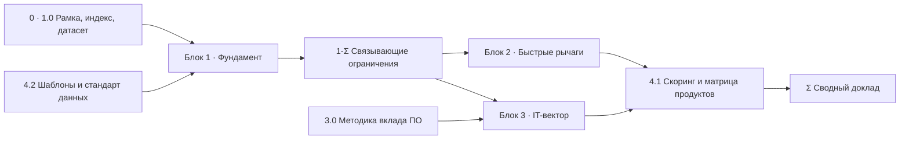

# Фундаментальные драйверы силы национальной экономики: от макрофакторов до роли IT-индустрии и разработки ПО

**Master Roadmap исследования** · версия 1.5 · 15.10.2026 · статус: план

Дорожная карта крупного аналитического исследования. Каждый пункт и подпункт — заготовка отдельного документа: аналитической записки, датасета, кейс-досье, методики или whitepaper. План отвечает на три вопроса: что делает экономику сильной в долгую (Блок 1), что даёт ускорение в горизонте 1–3 лет (Блок 2) и где разработчик ПО создаёт для страны наибольшую стоимость (Блок 3). Блок 4 превращает ответы в рабочий инструмент: скоринг IT-продуктов и стандарт дочерних документов.

## Содержание

- 0. Рамка исследования
- Блок 1. Фундаментальный макроэкономический анализ — что делает экономику сильной
- Блок 2. Тактические драйверы и быстрый буст экономики — «здесь и сейчас»
- Блок 3. Роль разработчика ПО и стратегический вектор в IT
- Блок 4. Практическая матрица продуктов и методология реализации плана
- Итоговый синтез
- Приложение А. Реестр артефактов
- Приложение Б. Связь с практикой VESHA
- Журнал версий

---

## 0. Рамка исследования

### 0.1. Объект, горизонты, единица анализа

- **Объект** — национальная экономика как система. Базовый объект приложения — Россия; выводы проверяются на сравнительной панели стран (0.4).
- **Три горизонта.** Фундамент (Блок 1) — медленные переменные, 10–30 лет. Тактика (Блок 2) — рычаги с эффектом за 1–3 года. IT-вектор (Блок 3) — 3–10 лет: путь от продукта до изменения производительности целых отраслей.
- **Единица анализа** меняется по блокам: страна и отрасль (Блок 1), предприятие и процесс (Блок 2), класс ПО и продукт (Блоки 3–4).
- **Ограничение данных.** С 2022 г. часть российской статистики закрыта или выходит с задержкой (детальная внешняя торговля, отдельные ряды ЦБ и Росстата). Обход — зеркальная статистика стран-партнёров, альтернативные данные (вакансии, бухгалтерская отчётность, госзакупки, репозитории кода) и полевые обследования. Каждый документ явно помечает, на каких данных стоит вывод (4.2-C).

### 0.2. Что мы называем силой экономики

Рабочее определение: экономика сильна, если она

1. **растёт за счёт производительности** — устойчиво наращивает выпуск на занятого и совокупную факторную производительность (TFP), а не только численность занятых и объём капитала;
2. **усложняется** — производит и экспортирует всё более сложные продукты, растёт доля отечественной добавленной стоимости;
3. **финансирует себя и выдерживает шоки** — инвестирует из внутренних сбережений, проходит спады неглубоко и восстанавливается быстро;
4. **сохраняет свободу решений** — критические узлы (платежи, энергия, связь, ключевые технологии и ПО) нельзя отключить извне без замены в разумный срок.

Четыре измерения сводятся в композитный индекс (Документ 1.0-A). Индекс — инструмент сравнения, а не цель: каждый вывод проверяется на исходных индикаторах.

### 0.3. Теоретические линзы

| Линза | Что объясняет | Где применяется |
|---|---|---|
| Учёт источников роста (Солоу), TFP | какая часть роста — производительность, а какая — накопление факторов | 1.0-C, 1.2, 1.4 |
| Эндогенный рост (Ромер, Лукас) | знания и человеческий капитал как источник возрастающей отдачи | 1.2, 1.4, Блок 3 |
| Институциональная экономика (Норт; Аджемоглу и Робинсон) | правила игры, горизонт инвестиций, инклюзивные и экстрактивные институты | 1.1 |
| Экономическая сложность (Хаусман, Идальго) | сложность выпуска предсказывает рост; «соседние» продукты достижимы дешевле | 1.4-A, 1.5-A, 4.1 |
| Законы Калдора | обрабатывающая промышленность как двигатель производительности | 1.4, 2.2 |
| Голландская болезнь и ресурсное проклятие (Корден и Нири; Сакс и Уорнер) | как рента вытесняет обработку и портит институты | 1.5, 1.6 |
| Преимущества отсталости (Гершенкрон); ловушка среднего дохода | почему догоняющий рост замедляется и как его продлить | 1.0, кейсы |
| Техно-экономические парадигмы (Перес); технологические уклады (Глазьев) | смена базовых технологий и окна возможностей | 1.4-A |
| Технологии общего назначения (Бреснахан и Трахтенберг); J-кривая производительности (Бриньолфссон и соавт.) | почему эффект IT приходит с лагом и в отраслях-потребителях | Блок 3, 4.1-B |
| Новая промышленная политика (Родрик; Мадзукато; Лин) | когда государство ускоряет структурные сдвиги, а когда консервирует слабых | Блок 2, 3.3 |
| Трансакционные издержки (Коуз, Уильямсон) | стоимость координации, согласований и контрактов | 2.3 |
| Теория ограничений (Голдратт); диагностика роста (Хаусман, Родрик, Веласко) | связывающее ограничение определяет отдачу всех прочих мер | 1-Σ, 2.4 |
| Невозможная троица (Манделл, Флеминг) | выбор между открытостью капитала, курсом и независимой политикой | 1.5-E |
| Межотраслевой баланс (Леонтьев) | прямые и косвенные эффекты спроса и предложения | 1.4-B, 2.4-A, 4.1-B |

### 0.4. Сравнительная панель стран

| Группа | Страны | Чем полезны исследованию |
|---|---|---|
| Успешный догоняющий рост | Южная Корея, Тайвань, Китай, Сингапур, Польша | промышленная политика, переход от копирования к созданию |
| Индустриальные лидеры | Германия, Япония, США, Швейцария, Финляндия | станкостроение, НИОКР, средний бизнес, профобразование |
| Ресурсные экономики с успехом | Норвегия, Австралия, Канада, Чили, Ботсвана | конвертация ренты в институты и технологии |
| Ресурсные экономики с провалом | Венесуэла, Нигерия; Нидерланды 1960-х как классика голландской болезни | что ломается и в какой последовательности |
| Ловушка среднего дохода | Аргентина, Бразилия, Мексика, Малайзия, Таиланд, Турция | почему рост останавливается |
| Развитие под ограничениями доступа к технологиям | СССР (история), Иран, Китай после экспортного контроля 2018–2024 | технологическая автономия: цена и пределы |
| IT как экспортная отрасль | Индия, Израиль, Беларусь до 2020 г., Эстония | связь IT-экспорта с внутренней производительностью |
| Партнёры по интеграции | Казахстан, Беларусь, Армения, Узбекистан | общий рынок, кадры, экспорт ПО и оборудования |

### 0.5. Сквозные гипотезы

Гипотезы — не аксиомы. У каждой указано, что её опровергнет, и документы, которые её проверяют, обязаны сообщать и подтверждения, и опровержения.

| Код | Гипотеза | Проверяется в | Что опровергнет |
|---|---|---|---|
| H1 | Медленные переменные (институты, человеческий капитал) задают потолок долгосрочного роста; быстрые рычаги Блока 2 дают устойчивый эффект только там, где фундамент — не связывающее ограничение. | 1.0-C, 1.1-Σ, 1-Σ, 2-Σ | быстрые рычаги дают устойчивый рост TFP при неизменных институтах (Китай 1980–2000-х — главный проверочный кейс) |
| H2 | При исторически низкой безработице главный резерв роста — производительность труда (автоматизация, переобучение, организация), а не численность занятых. | 1.2-F, 2.1, 2.2 | экстенсивный прирост занятых (миграция, участие старших возрастов) даёт выпуск дешевле автоматизации |
| H3 | Вклад ПО в ВВП определяется прежде всего ростом производительности в отраслях-потребителях, а не собственной добавленной стоимостью IT-отрасли; максимум — у софта, встроенного в производственные процессы реального сектора. | 3.0-A, 3.2-Σ, 4.1-B | мультипликатор потребительского и рекламного софта сопоставим с промышленным при одинаковой методике |
| H4 | Заметная доля дефицитных инженерных кадров занята в нишах с низкой добавленной стоимостью на инженера и нулевым или отрицательным эффектом для других отраслей; причина — ценовые и налоговые сигналы, а не «выбор» разработчиков. | 3.0-B, 3.1 | доля таких ниш мала (менее 5–10 % занятых разработчиков) или их кадры не переходят в реальный сектор при выравнивании стимулов |
| H5 | Суверенитет — не автаркия: минимальная по стоимости устойчивость достигается контролем ограниченного набора критических узлов при открытости в остальном. | 1.4-Σ, 3.3-D | кейсы показывают, что частичный контроль не защищает: отключение одного узла парализует систему независимо от остальных |
| H6 | Ресурсная рента — базис, а не проклятие, если она конвертируется в спрос на отечественные технологии (нефтесервис, горная техника, промышленный софт), а не только в импорт и резервы. | 1.6-B, 1.6-C | страны с высокой долей локального технологического контента в добыче растут не быстрее сопоставимых |

### 0.6. Кодировка документов и формат пунктов

- **Код** — `<блок>.<направление>-<подтема>`: «Документ 2.2-E» — блок 2, направление 2, подтема E. Кластеры Блока 3 добавляют номер: «3.2-A4». Синтез направления — «1.3-Σ», блока — «1-Σ», всего исследования — «Σ».
- **Тип** — в квадратных скобках после кода:

| Тип | Что это | Ориентир объёма |
|---|---|---|
| W | whitepaper — синтез и позиция | 30–60 стр. |
| A | аналитическая записка — ответ на вопросы подтемы | 10–25 стр. |
| D | датасет с паспортом и записка к нему | таблицы + 5–10 стр. |
| K | кейс-досье — сравнительный разбор кейсов | 15–30 стр. |
| M | методика — воспроизводимый способ расчёта | 5–15 стр. + код |
| S | скоринговая карточка продукта | 1–2 стр. |

- **Формат.** У каждого направления — суть феномена, метрики, кейсы успеха и провала и итоговый синтез. У каждой подтемы — четыре поля: цель этапа, ключевые исследовательские вопросы (3–5), источники данных и методы, ожидаемый артефакт. Правила оформления самих документов — в 4.2.

### 0.7. Карта зависимостей и волны



| Волна | Что входит | Условие старта | Оценка длительности |
|---|---|---|---|
| 0. Подготовка | 4.2, 1.0, 3.0-A, черновик формулы 4.1-A | — | 4–6 недель |
| 1. Фундамент | 1.1–1.6 параллельно, 3.0-B | паспорт данных 1.0-B | 10–14 недель |
| 2. Тактика и критика | 1-Σ, Блок 2, 3.1 | черновик 1-Σ | 8–10 недель |
| 3. IT-кластеры | 3.2, 3.3 | 3.0 и 3.1 | 10–12 недель |
| 4. Синтез | 4.1-B…E, 3-Σ, Σ | синтезы всех направлений | 6–8 недель |

Длительности — планировочная оценка для команды из 3–5 аналитиков; волны 1–3 частично перекрываются. В режиме «документ пишет агент, человек рецензирует» узкое место — не написание, а доступ к данным и проверка выводов; длительности пересматриваются по итогам волны 0.

### 0.8. Файлы и папки

Главный документ — этот план. Дочерние документы лежат рядом, по папкам блоков:

```text
docs/economic-strength/
  economic-strength-roadmap.md      главный документ: рамка, вопросы, реестр
  1-foundations/                    Блок 1
    1.0-A-strength-index.md         подтема — свой файл
    1.1-sum-institutions.md         синтез направления
    1-sum-binding-constraints.md    синтез блока
  2-tactics/                        Блок 2
  3-software/                       Блок 3
  4-method/                         Блок 4
    4.2-research-standard.md        лёгкое направление — один файл
  data/<код>/                       производные таблицы и паспорта рядов
  sum-final-report.md               итоговый сводный доклад
```

Правила разбивки:

- **Одна строка реестра — один файл.** Единица — артефакт с кодом. Тяжёлое направление (1.0, 1.1, …) раскладывается на файлы по подтемам плюс синтез; лёгкое остаётся одним файлом, а его подтемы становятся разделами. Сейчас так объединено только направление 4.2: пять коротких регламентов читаются и меняются вместе.
- **Раздел 0 остаётся в плане.** Это договорённости, на которых стоит весь план, а не исследовательские вопросы. У его пунктов уже есть исследовательские двойники: 0.2 → 1.0-A, 0.4 → 1.0-B, 0.6 → 4.2, 0.7 → реестр (Приложение А).
- **Файл появляется, когда начинается работа.** Пустых заготовок нет: пока файла нет, документ числится в реестре со статусом «план» — пятно видно, а не спрятано.
- **Имя файла** — `<код>-<slug>.md`, slug — английский kebab-case, как во всём `docs/`; «Σ» в имени пишется как `sum`.
- **Данные.** Производные таблицы (до 1 МБ) и паспорта рядов — в `data/<код>/` этой папки; сырые выгрузки — в `data/economic-strength/<код>/raw/` в корне репозитория (вне git, как корпуса радаров).
- **Реестр** (Приложение А) строит скрипт `scripts/economic-strength-registry.mjs`: он читает этот план и файлы в папке и проставляет статус и ссылку на файл.

### 0.9. Трек разработчика

Волны 0–4 рассчитаны на исследование целиком. Параллельно, вне очереди волн, идёт трек разработчика: документы, после которых можно писать код продукта. Теоретические документы (1.0-A, 1.0-B, 1.0-C, 3.0-A и дальше по волнам) идут своим ходом и трек не блокируют. Внутри теоретического трека первыми идут пункты, которые могут поменять выбор продукта (Д5); рамка и остальной Блок 1 — после них.

| Шаг | Что | Документ | Что получает разработчик |
|---|---|---|---|
| Д1 | Короткий список кандидатов на данных рынка | [4.1-E v0.2](4-method/4.1-E-candidates.md): 11 кандидатов, атлас [2.2-C](2-tactics/2.2-C-routine-tasks-atlas.md) — **сделан** | костяк (сайт, канбан, ассистент, слот инструмента) и тройка инструментов-лидеров |
| Д2 | Выбор продукта | решение владельца исследования | — |
| Д3 | Оглавление MVP | [backbone-architecture.md](../backbone-architecture.md) — костяк и разбор заявки в счёт, вне реестра исследования — **сделан** | с чего начинать код: шаги 1–6 |
| Д4 | Протокол замера эффекта у первого клиента | 4.1-B, часть «протокол»; метрики и теневой режим уже заданы в [backbone-architecture.md](../backbone-architecture.md), 6.6 | какие метрики встроить в продукт с первого дня |
| Д5 | Замеры, которые выбирают инструмент | по таблице 6.3 документа 4.1-E: доля B2B-заявок в нише (аудит сайтов, 2.3-D), эффект у первого клиента (4.1-B), эффект и цена мониторинга (2.2-E, 2.4-E, 2.2-D), конкуренты раскроя (2.2-C v0.2), число цехов (2.2-A) | какой инструмент из тройки лидеров первый |
| Д6 | Зависимости стека от открытого кода | 3.3-A на одном продукте | лицензии и риски библиотек до того, как они вросли в код |

---

## Блок 1. Фундаментальный макроэкономический анализ — что делает экономику сильной

Блок отвечает на вопрос «почему одни экономики устойчиво богатеют, а другие нет» и ставит диагноз российской экономике в сравнительной панели. Итог блока — карта связывающих ограничений роста (1-Σ), на которую опираются Блоки 2 и 3.

### 1.0. Рамка: как мерить силу экономики

Сквозное направление: определяет общий язык, индекс и данные для всех остальных документов.

#### 1.0-A. Индекс силы экономики

- **Цель этапа:** перевести определение из 0.2 в измеримый композитный индекс и проверить, что он предсказывает долгосрочный рост лучше отдельных индикаторов.
- **Ключевые исследовательские вопросы:**
  1. Какие индикаторы каждого из четырёх измерений лучше всего предсказывают рост ВВП на душу на горизонте 10–20 лет?
  2. Как взвесить измерения (главные компоненты, экспертные веса, равные веса) и насколько устойчив ранг стран к выбору весов?
  3. Чем индекс отличается от существующих (Глобальный индекс инноваций WIPO, индекс экономической сложности; рейтинг конкурентоспособности ВЭФ не публикуется с 2020 г.) и что он добавляет?
  4. Как измерить устойчивость к шокам — глубину спада и время восстановления в 2008–2009, 2014–2015, 2020 и 2022 гг.?
- **Источники данных и методы:** Penn World Table, Maddison Project, WDI Всемирного банка, IMF WEO, Atlas of Economic Complexity, Global Innovation Index; методика построения композитных индексов OECD/JRC, метод главных компонент, анализ чувствительности весов методом Монте-Карло, ретроспективная проверка предсказательной силы.
- **Ожидаемый артефакт:** *Документ 1.0-A [M]: Методика индекса силы экономики и пилотный расчёт для 30 стран*

#### 1.0-B. Единая панель индикаторов

- **Цель этапа:** собрать одну машиночитаемую панель данных, из которой берут цифры все документы, — чтобы разные записки не спорили из-за разных источников одного ряда.
- **Ключевые исследовательские вопросы:**
  1. Какие ряды доступны за 1990–2025 гг., с какой частотой и разбивкой (отрасли, регионы)?
  2. Где разрывы в российских данных после 2022 г. и чем их замещать (зеркальная статистика, альтернативные источники)?
  3. Как вести происхождение и версии каждого ряда, чтобы любой вывод можно было воспроизвести?
  4. Какой минимальный набор индикаторов нужен каждому блоку?
- **Источники данных и методы:** API WDI, IMF IFS и DOTS, OECD Data Explorer, UN Comtrade, ЕМИСС и Росстат, ЦБ РФ, Минфин; конвейер загрузки, словарь индикаторов, паспорт ряда (4.2-C), автоматические проверки согласованности.
- **Ожидаемый артефакт:** *Документ 1.0-B [D]: Панель «Индикаторы силы экономики» v1 со словарём и паспортами рядов*

#### 1.0-C. Источники роста российской экономики

- **Цель этапа:** разложить рост 2000–2025 гг. на вклад капитала, труда, качества труда и TFP и понять, на чём держался рост в каждый период.
- **Ключевые исследовательские вопросы:**
  1. Какая доля роста приходится на TFP и на накопление факторов в 2000–2008, 2009–2013, 2014–2021 и 2022–2025 гг.?
  2. В каких отраслях TFP росла, а в каких падала?
  3. Что показывает сравнение с Польшей, Турцией, Казахстаном и Малайзией за те же периоды?
  4. Каков потенциальный рост при текущей демографии, норме накопления и трендовой TFP?
- **Источники данных и методы:** Russia KLEMS (НИУ ВШЭ), EU KLEMS, Penn World Table, Conference Board Total Economy Database; учёт источников роста по Солоу, отраслевая декомпозиция KLEMS, оценка потенциального выпуска через производственную функцию.
- **Ожидаемый артефакт:** *Документ 1.0-C [A]: Источники роста российской экономики в 2000–2025 гг.: что дала производительность*

---

### 1.1. Институты и правовая среда

**Суть феномена.** Институты — «правила игры» (Норт): защита собственности, суды, предсказуемость государства. Они определяют горизонт планирования и цену капитала. Слабые институты проявляются не прямо, а через поведение: премию за риск в ставке, короткий горизонт инвестиций, вывод капитала, выбор быстрых торговых сделок вместо долгих производственных проектов. Для промышленности и тяжёлого ПО, где окупаемость — 5–10 лет, это главный фильтр.

**Метрики и индикаторы.**

| Индикатор | Источник | Что показывает |
|---|---|---|
| Worldwide Governance Indicators: верховенство права, качество регулирования, контроль коррупции, эффективность правительства | Всемирный банк | институциональный профиль в сравнении |
| International Property Rights Index | Property Rights Alliance | защита физической и интеллектуальной собственности |
| WJP Rule of Law Index | World Justice Project | доступность и независимость правосудия |
| Индекс восприятия коррупции | Transparency International | восприятие коррупции |
| Economic Freedom of the World | Fraser Institute | экономическая свобода, включая правовую систему |
| Доля выигранных бизнесом споров с госорганами | картотека арбитражных дел | баланс сил «бизнес — государство» |
| Частота существенных изменений Налогового кодекса и отраслевых законов | правовые базы | предсказуемость правил |
| Чистый вывоз капитала частным сектором | ЦБ РФ, платёжный баланс | голосование капиталом |
| Доля частных внебюджетных источников в инвестициях в основной капитал | Росстат | готовность частника вкладываться в долгое |

**Кейсы.**

| Кейс | Итог | Что извлечь |
|---|---|---|
| Сингапур после 1960 г.: антикоррупционное бюро, независимые суды, предсказуемость | успех | институты можно построить за поколение при политической воле |
| Эстония: цифровое государство, X-Road | успех | цифровизация как средство прозрачности и снижения издержек |
| Китай 1980–2010-х: рост при слабой формальной защите собственности | парадокс | неформальные гарантии и конкуренция регионов как временный заменитель |
| Аргентина: дефолты, заморозка вкладов 2001 г., смена правил | провал | хроническая непредсказуемость сокращает горизонт до 1–2 лет |
| Венесуэла: экспроприации 2000-х | провал | разрушение собственности обрушивает инвестиции и добычу |
| Россия 1990-х: залоговые аукционы и спор о легитимности собственности | урок | нелегитимная собственность не защищается и не инвестируется вдолгую |

#### 1.1-A. Защита права собственности и исполнение контрактов

- **Цель этапа:** измерить, насколько надёжно защищена собственность (в том числе от государства) и сколько стоит исполнить договор; оценить связь с инвестициями и горизонтом планирования.
- **Ключевые исследовательские вопросы:**
  1. Каковы время, стоимость и вероятность принудительного исполнения коммерческого договора (арбитраж, ФССП) и как они менялись с 2010 г.?
  2. Насколько собственность защищена от изъятия и перераспределения (рейдерство, уголовное давление, иски о возврате активов в госсобственность 2023–2025 гг.) и как это отражается в премии за риск?
  3. Какова связь индексов защиты собственности с долей частных инвестиций и закладываемым сроком окупаемости в панели стран?
  4. Какие частные заменители слабой публичной защиты (зарубежные холдинги и право, соглашения о защите и поощрении капиталовложений) использовались и что изменилось после 2022 г.?
- **Источники данных и методы:** International Property Rights Index, WGI, статистика Судебного департамента при ВС РФ и ФССП, исследования Института проблем правоприменения, доклады РСПП о деловом климате, опросы «Деловой России»; панельная регрессия инвестиций на институциональные индексы с инструментальными переменными, кейс-метод.
- **Ожидаемый артефакт:** *Документ 1.1-A [A]: Цена незащищённой собственности — премия за риск и короткий горизонт инвестиций*

#### 1.1-B. Независимость и качество судебной системы

- **Цель этапа:** оценить, насколько суды — независимый и предсказуемый арбитр в экономических спорах, особенно бизнеса с государством и крупными игроками.
- **Ключевые исследовательские вопросы:**
  1. Каковы исходы споров бизнеса с госорганами (налоговые, административные, антимонопольные дела) и как они менялись во времени?
  2. Насколько предсказуема практика: каков разброс решений по однотипным делам и как его снижает Верховный суд?
  3. Какая доля уголовных дел по экономическим статьям прекращается или заканчивается оправданием, и как это влияет на поведение предпринимателей?
  4. Какие механизмы повышают доверие (специализированные суды, коммерческий арбитраж, международный арбитраж) и что из них доступно сейчас?
- **Источники данных и методы:** картотека арбитражных дел (массовый текстовый анализ решений), Судебный департамент, WJP Rule of Law Index, Институт проблем правоприменения; NLP-классификация исходов, сравнение с панелью.
- **Ожидаемый артефакт:** *Документ 1.1-B [A]: Суд как инфраструктура — предсказуемость решений по экономическим спорам*

#### 1.1-C. Патентное и авторское право, режим интеллектуальной собственности

- **Цель этапа:** понять, стимулирует ли режим ИС создание технологий и ПО внутри страны, и оценить последствия ослабления защиты прав иностранных правообладателей после 2022 г.
- **Ключевые исследовательские вопросы:**
  1. Какова динамика патентования резидентами (заявки, выдачи, PCT) в приоритетных технологиях и какая доля патентов реально используется (лицензии, внедрение)?
  2. Как параллельный импорт и снижение компенсации по принудительным лицензиям для части иностранных правообладателей повлияли на доступ к технологиям и на стимулы отечественных разработчиков?
  3. Как защищено ПО (авторское право, регистрация, патенты на программно-технические решения) и где защита мешает (обратная разработка ради совместимости)?
  4. Какие режимы ИС помогали догоняющим странам — мягкая защита на старте и ужесточение по мере роста собственных разработок (Япония, Корея, Китай)?
- **Источники данных и методы:** годовые отчёты Роспатента и ФИПС, статистика WIPO и PCT, данные о лицензионных договорах; патентные ландшафты, сравнительно-исторический анализ.
- **Ожидаемый артефакт:** *Документ 1.1-C [A]: Режим интеллектуальной собственности как инструмент догоняющего развития*

#### 1.1-D. Предсказуемость регулирования и налоговой системы

- **Цель этапа:** измерить частоту и неожиданность изменений правил (налоги, тарифы, обязательные требования) и их влияние на долгие инвестиции.
- **Ключевые исследовательские вопросы:**
  1. Сколько существенных изменений вносится в Налоговый кодекс и ключевые отраслевые законы в год и какая их доля вступает в силу менее чем через 6 месяцев после принятия?
  2. Как изменения правил отражаются в ожиданиях бизнеса и в отложенных инвестиционных решениях?
  3. Какие механизмы «заморозки правил» работают (стабилизационные оговорки, соглашения о защите и поощрении капиталовложений, специальные инвестиционные контракты) и каков их охват?
  4. Каков реальный эффект «регуляторной гильотины» 2020–2021 гг. по опросам бизнеса, а не по числу отменённых актов?
- **Источники данных и методы:** редакции законов в правовых базах (счёт и классификация изменений), мониторинг предприятий ЦБ РФ, индекс неопределённости экономической политики (EPU, Бейкер, Блум и Дэвис), текстовый анализ.
- **Ожидаемый артефакт:** *Документ 1.1-D [D]: Индекс регуляторной изменчивости России 2010–2026 и его связь с инвестициями*

#### 1.1-E. Коррупция и стоимость административной ренты

- **Цель этапа:** оценить масштаб и формы коррупции как налога на бизнес — в закупках, разрешениях и контроле, — и её влияние на отбор технологий.
- **Ключевые исследовательские вопросы:**
  1. Какова «административная рента» в стоимости проектов по опросам и по ценовым аномалиям контрактов?
  2. Где сосредоточены риски: закупки у единственного поставщика, ценовые отклонения, разрешения, проверки?
  3. Какие цифровые механизмы (электронные закупки, открытые данные, прозрачность бенефициаров) снижали коррупцию в других странах и в России?
  4. Как коррупционная рента искажает выбор технологий в импортозамещении (откат против качества)?
- **Источники данных и методы:** открытые данные ЕИС закупок, проект «Госзатраты», Enterprise Surveys и BEEPS (Всемирный банк и ЕБРР), CPI; метод «красных флагов» в закупках, сравнение цен однотипных контрактов, кейсы Грузии, Сингапура, Эстонии и ProZorro.
- **Ожидаемый артефакт:** *Документ 1.1-E [A]: Коррупционная рента в закупках технологий — метод красных флагов и оценка потерь*

#### 1.1-F. Инвестиционный климат и стоимость капитала

- **Цель этапа:** свести институциональные факторы к цене капитала и горизонту инвестиций — главной переменной для производственных и софтверных проектов.
- **Ключевые исследовательские вопросы:**
  1. Какова стоимость капитала (WACC) для промышленного проекта в России по сравнению с панелью и из чего она складывается (безрисковая ставка, страновая премия, институциональная премия)?
  2. Как ключевая ставка и льготные программы (займы ФРП, субсидирование ставок, проектное финансирование) меняют реальную цену денег для разных классов заёмщиков?
  3. Какая доля инвестиций в основной капитал приходится на частные внебюджетные источники и как она реагирует на институциональные шоки?
  4. Какие классы проектов окупаются при текущей стоимости капитала, а какие отсекаются (станкостроение, микроэлектроника, тяжёлое ПО)?
- **Источники данных и методы:** ставки по кредитам нефинансовым организациям (ЦБ РФ), инвестиции по источникам (Росстат), страновые премии Дамодарана, опросы финансовых директоров; моделирование WACC, расчёт порога NPV по отраслям.
- **Ожидаемый артефакт:** *Документ 1.1-F [A]: Цена капитала для промышленного и софтверного проекта — что отсекает ставка*

#### Итог направления 1.1

- **Цель этапа:** собрать институциональный профиль страны и оценить, какие правила игры сильнее всего связывают рост.
- **Ключевые исследовательские вопросы:**
  1. Какие институциональные дефекты дороже всего обходятся экономике в пунктах роста?
  2. Какие из них можно исправить за 3–5 лет, а какие требуют поколения?
  3. Какие частные и цифровые заменители смягчают дефекты и какова их цена?
- **Источники данных и методы:** документы 1.1-A…F, экспертная панель (метод Дельфи), сравнение с панелью стран.
- **Ожидаемый артефакт:** *Документ 1.1-Σ [W]: Институциональный профиль — какие правила игры связывают рост и сколько это стоит*

---

### 1.2. Человеческий капитал и демография

**Суть феномена.** Человеческий капитал — это численность × квалификация × здоровье × размещение (кто где работает). В России к этому добавляется демографическая волна: в трудоспособный возраст входят малочисленные когорты 1990-х, безработица исторически низкая, кадровый голод — один из главных ограничителей выпуска. Значит, рост возможен прежде всего через качество и производительность, а не через численность (гипотеза H2).

**Метрики и индикаторы.**

| Индикатор | Источник | Что показывает |
|---|---|---|
| Индекс человеческого капитала | Всемирный банк | ожидаемая продуктивность следующего поколения |
| TIMSS, PIRLS, национальные оценки (ВПР, ЕГЭ по профильной математике, физике, информатике) | IEA, Рособрнадзор | базовые компетенции школы |
| Численность исследователей на 1 млн жителей, их возраст | ИСИЭЗ ВШЭ, UNESCO UIS | масштаб и старение науки |
| Доля выпускников STEM, трудоустройство по специальности | Минобрнауки, мониторинг трудоустройства выпускников | инженерная воронка |
| Ожидаемая продолжительность здоровой жизни (HALE), смертность в трудоспособном возрасте | ВОЗ, Росстат | годы активной жизни |
| Суммарный коэффициент рождаемости, демографическая нагрузка | Росстат, UN WPP | будущая численность занятых |
| Уровень безработицы, соотношение вакансий и соискателей | Росстат, hh.индекс | напряжённость рынка труда |
| Эмиграция и возврат высококвалифицированных | статистика стран приёма, OECD | баланс талантов |
| Отдача от образования (премия к зарплате) | обследования рабочей силы | ценит ли рынок квалификацию |

**Кейсы.**

| Кейс | Итог | Что извлечь |
|---|---|---|
| Финляндия: реформа школы 1970-х | успех | равное качество школ как основа инженерной базы |
| Германия, Швейцария: дуальное профобразование | успех | роль работодателя и торговых палат в подготовке рабочих |
| Южная Корея: массовое высшее образование | успех с издержками | рост навыков и проблема переобразования |
| Израиль 1990-х: около миллиона переселенцев из СССР | успех | приём готового человеческого капитала и его встраивание |
| Китай: программы возврата учёных | успех с оговорками | возврат диаспоры как ускоритель науки |
| Восточная Европа после вступления в ЕС | провал по демографии | эмиграция молодых вымывает рабочую силу |
| Россия 1990-х: утечка учёных и инженеров | провал | потеря поколения в науке восстанавливается десятилетиями |
| Япония: старение и стагнация | урок | демография без производительности тянет рост вниз |

#### 1.2-A. Фундаментальная наука и исследовательские кадры

- **Цель этапа:** оценить масштаб, качество, возраст исследовательского корпуса и его связь с технологиями.
- **Ключевые исследовательские вопросы:**
  1. Какова численность, возрастная структура и динамика исследователей по областям (физика, химия, математика, информатика, материаловедение)?
  2. Каков вклад российской науки в мировую по открытым библиометрическим данным после ограничения доступа к Scopus и Web of Science и как изменилась международная кооперация?
  3. Как устроено финансирование (госзадание, гранты РНФ, заказ компаний) и как форма финансирования связана с результативностью?
  4. Какая доля фундаментальных результатов доходит до прикладных разработок (ссылки на науку в патентах)?
- **Источники данных и методы:** «Индикаторы науки» ИСИЭЗ ВШЭ, форма 2-наука Росстата, OpenAlex, отчёты РНФ, UNESCO UIS, набор Reliance on Science (ссылки патентов на статьи); библиометрия, сравнение с панелью.
- **Ожидаемый артефакт:** *Документ 1.2-A [A]: Исследовательский корпус страны — численность, возраст, продуктивность, связь с технологиями*

#### 1.2-B. Высшее инженерное образование

- **Цель этапа:** оценить, сколько и каких инженеров готовит система и насколько они соответствуют потребностям отраслей.
- **Ключевые исследовательские вопросы:**
  1. Сколько выпускников инженерных и IT-направлений выпускается в год и какая доля работает по специальности через 1–3 года?
  2. Какая доля обучения идёт на актуальном оборудовании и ПО (в том числе отечественных САПР и ПЛК) и кто его предоставляет?
  3. Как устроены связи вузов с предприятиями (базовые кафедры, целевое обучение, совместные лаборатории) и каков их эффект?
  4. Как переход от бакалавриата и магистратуры к новой системе уровней высшего образования влияет на инженерную подготовку?
- **Источники данных и методы:** мониторинг трудоустройства выпускников Минобрнауки, итоги приёмных кампаний, hh.ru; интервью с работодателями, сравнение с Германией, Кореей и Китаем.
- **Ожидаемый артефакт:** *Документ 1.2-B [A]: Инженерная воронка — от абитуриента до работающего инженера, где теряем*

#### 1.2-C. Среднее профессиональное образование и рабочие кадры

- **Цель этапа:** измерить дефицит рабочих кадров и качество их подготовки, оценить эффект «Профессионалитета» и переносимость дуальных моделей.
- **Ключевые исследовательские вопросы:**
  1. Каков дефицит по рабочим профессиям (наладчик станков с ЧПУ, сварщик, электромонтажник, слесарь-ремонтник, оператор линии) и какова его динамика?
  2. Каков реальный уровень выпускников СПО (демонстрационные экзамены, оценка работодателей) и оснащённость колледжей?
  3. Почему молодёжь не выбирает рабочие профессии (зарплата, статус, условия) и меняется ли это при росте зарплат 2023–2025 гг.?
  4. Что из дуальной модели Германии и Швейцарии переносимо, а что держится на институтах, которых в России нет (обязательства торговых палат, отраслевые союзы)?
- **Источники данных и методы:** обследование рабочей силы и форма 57-Т (зарплаты по профессиям) Росстата, данные Минпросвещения по «Профессионалитету», hh.ru; полевые интервью на 10–15 заводах.
- **Ожидаемый артефакт:** *Документ 1.2-C [A]: Рабочие руки — дефицит по профессиям и эффективность «Профессионалитета»*

#### 1.2-D. Школа и воронка в STEM

- **Цель этапа:** понять, сколько школьников система доводит до инженерных и естественнонаучных направлений и где воронка сужается.
- **Ключевые исследовательские вопросы:**
  1. Каков уровень математической и естественнонаучной подготовки по международным и национальным оценкам и как он менялся?
  2. Сколько школьников сдают физику, профильную математику и информатику и как это связано с поступлением на инженерные направления?
  3. Каков региональный разрыв в качестве школ и в обеспеченности учителями математики и физики?
  4. Каков эффект программ дополнительного образования (технопарки, IT-кубы, олимпиадное движение, «Сириус») на воронку?
- **Источники данных и методы:** статистика ЕГЭ Рособрнадзора, данные ФИОКО, TIMSS и PIRLS, региональная статистика; анализ воронки по когортам.
- **Ожидаемый артефакт:** *Документ 1.2-D [D]: Воронка STEM — от школьника до инженерного вуза по регионам*

#### 1.2-E. Здоровье и продолжительность активной жизни

- **Цель этапа:** оценить годы трудоспособной жизни как экономический ресурс и найти самые дешёвые способы их прибавить.
- **Ключевые исследовательские вопросы:**
  1. Какова ожидаемая продолжительность здоровой жизни и смертность в трудоспособном возрасте, прежде всего мужская, по сравнению с панелью?
  2. Какие причины сильнее всего сокращают трудоспособную жизнь (сердечно-сосудистые болезни, внешние причины, алкоголь) и каков ущерб в человеко-годах и ВВП?
  3. Какие меры здравоохранения дают наибольший прирост лет трудоспособной жизни на рубль?
  4. Как повышение пенсионного возраста соотносится со здоровьем и производительностью старших работников?
- **Источники данных и методы:** смертность по причинам (Росстат), WHO Global Health Observatory, Global Burden of Disease (IHME), Human Mortality Database; расчёт DALY и потерь выпуска, анализ «затраты — эффективность».
- **Ожидаемый артефакт:** *Документ 1.2-E [A]: Годы трудоспособной жизни как ресурс — потери и самые дешёвые резервы*

#### 1.2-F. Демографическая структура и рынок труда

- **Цель этапа:** построить коридор численности рабочей силы до 2040 г. и оценить, чем закрывать разрыв.
- **Ключевые исследовательские вопросы:**
  1. Как изменится численность трудоспособного населения до 2040 г. при разных сценариях рождаемости, смертности и миграции?
  2. Где дефицит занятых уже ограничивает выпуск (по опросам предприятий о лимитирующих факторах) и сколько выпуска он «съедает»?
  3. Каковы резервы участия: женщины, старшие возрасты, люди с инвалидностью, неформально занятые, регионы с высокой безработицей?
  4. Какую роль играет трудовая миграция (объём, квалификация, отрасли, издержки) и где она дешевле автоматизации, а где дороже?
- **Источники данных и методы:** демографический прогноз и обследование рабочей силы Росстата, UN World Population Prospects, мониторинг предприятий ЦБ РФ, прогнозы ИНП РАН, данные о миграции; когортно-компонентное моделирование.
- **Ожидаемый артефакт:** *Документ 1.2-F [A]: Демографический коридор 2026–2040 — сколько будет рабочих рук и чем закрывать разрыв*

#### 1.2-G. Удержание и привлечение талантов

- **Цель этапа:** оценить баланс утечки и притока высококвалифицированных специалистов и цену их удержания.
- **Ключевые исследовательские вопросы:**
  1. Каков масштаб эмиграции и возврата специалистов (IT, наука, инженерия) после 2022 г. по данным стран приёма и косвенным признакам?
  2. Какие факторы определяют решение уехать, остаться или вернуться (зарплата, риски, профессиональная среда, семья)?
  3. Какие инструменты удержания работали (IT-льготы, льготная ипотека, отсрочки) и сколько стоит один удержанный специалист?
  4. Какие механизмы привлечения из других стран сработали (Израиль 1990-х, Китай, Сингапур) и что применимо к русскоязычной диаспоре и специалистам из ЕАЭС и Азии?
- **Источники данных и методы:** OECD International Migration Outlook, национальная статистика Грузии, Армении, Казахстана, Сербии, независимые опросы релокантов, активность резюме на hh.ru, данные Минцифры; сравнительный кейс-анализ.
- **Ожидаемый артефакт:** *Документ 1.2-G [A]: Баланс талантов — утечка, возврат и цена удержания одного специалиста*

#### Итог направления 1.2

- **Цель этапа:** свести баланс человеческого капитала на 2026–2040 гг. и выделить рычаги, которые дают отдачу быстрее демографии.
- **Ключевые исследовательские вопросы:**
  1. По каким профессиональным группам дефицит станет связывающим ограничением и когда?
  2. Какие рычаги (здоровье, переобучение, участие, миграция, автоматизация) закрывают дефицит дешевле всего?
  3. Где образование готовит не тех и не там — и сколько это стоит?
- **Источники данных и методы:** документы 1.2-A…G, балансовая модель спроса и предложения труда по профессиям.
- **Ожидаемый артефакт:** *Документ 1.2-Σ [W]: Баланс человеческого капитала 2026–2040 — дефицит по профессиональным группам и рычаги его закрытия*

---

### 1.3. Физическая и цифровая инфраструктура

**Суть феномена.** Инфраструктура — общий знаменатель издержек всех отраслей: транспорт, энергия, связь и вычисления. Её слабость видна как потолок: заказ есть, мощность есть, но груз не вывезти, завод не подключить к сети, ДЦ не получить мегаватты. После разворота грузопотоков на восток в 2022 г. узкие места сместились, а критическая информационная инфраструктура (КИИ) стала отдельным фронтом: на значимых объектах КИИ с 2025 г. запрещено иностранное ПО (указ № 166).

**Метрики и индикаторы.**

| Индикатор | Источник | Что показывает |
|---|---|---|
| Logistics Performance Index | Всемирный банк | качество логистики в сравнении |
| Liner Shipping Connectivity Index | UNCTAD | связанность портов с мировыми линиями |
| Пропускная способность и загрузка Восточного полигона, подходов к портам, погранпереходов | РЖД, Минтранс | узкие места магистралей |
| Конечная цена кВт·ч для промышленности по уровням напряжения и регионам | НП «Совет рынка», АТС, ФАС | цена энергии для индустрии |
| Срок и стоимость техприсоединения к электросетям | сетевые компании, опросы | скорость запуска производства |
| Потери в сетях, показатели надёжности (SAIDI, SAIFI) | Минэнерго, Россети | качество энергоснабжения |
| Покрытие и скорость мобильной и фиксированной связи | Минцифры, Ookla, ITU | цифровая доступность |
| Мощность ДЦ (стойко-места, МВт ИТ-нагрузки), загрузка | iKS-Consulting, операторы ДЦ | вычислительная база |
| Доля отечественного ПО и оборудования на значимых объектах КИИ | ФСТЭК, отраслевые опросы | технологическая независимость КИИ |

**Кейсы.**

| Кейс | Итог | Что извлечь |
|---|---|---|
| Китай: порты, железные дороги, скоростные магистрали | успех | инфраструктура впереди спроса как стратегия, но с долговыми рисками |
| Норвегия, Исландия: дешёвая гидро- и геотермальная энергия | успех | энергия притягивает алюминий и ДЦ |
| Индия: цифровая публичная инфраструктура (Aadhaar, UPI) | успех | государственная платформа как ускоритель частных сервисов |
| Германия 2022–2024: цена энергии для промышленности | провал по конкурентоспособности | энергетика определяет судьбу энергоёмких отраслей |
| ЮАР: веерные отключения Eskom | провал | надёжность сети как фактор роста |
| Ирландия: ограничения на подключение ДЦ в районе Дублина | урок | ДЦ упираются в сеть раньше, чем в спрос |
| Атаки на энергосистемы и трубопроводы (2015–2021) | урок | КИИ уязвима через ПО и цепочки поставок |

#### 1.3-A. Транспортные коридоры и магистральная логистика

- **Цель этапа:** найти, где пропускная способность магистралей ограничивает экспорт и импорт после разворота грузопотоков, и сравнить экономику новых коридоров.
- **Ключевые исследовательские вопросы:**
  1. Где пропускная способность (Восточный полигон, подходы к портам, погранпереходы с Китаем, Монголией, Казахстаном) отстаёт от грузопотоков и насколько?
  2. Какова экономика коридоров «Север — Юг», Северного морского пути и сухопутных маршрутов в Китай: время, стоимость, надёжность против альтернатив?
  3. Какую долю конечной цены занимает транспорт в ключевых отраслях и как она зависит от расстояния?
  4. Какова отдача от инвестиций в транспорт (железные дороги, дороги, порты) по сравнению с Китаем и США?
- **Источники данных и методы:** отчёты РЖД и Минтранса, данные Росморречфлота и Росатома по СМП, UNCTAD, LPI; транспортные модели, гравитационные модели торговли, сценарии грузопотоков 2026–2030.
- **Ожидаемый артефакт:** *Документ 1.3-A [A]: Узкие места магистральной логистики — пропускная способность против грузопотоков 2026–2030*

#### 1.3-B. Логистические узлы и терминально-складская инфраструктура

- **Цель этапа:** оценить обеспеченность узлами (терминалы, сухие порты, склады) и найти узлы с наибольшим сетевым эффектом.
- **Ключевые исследовательские вопросы:**
  1. Какова обеспеченность современными складами и терминалами по регионам и где разрыв с потребностью?
  2. Как связаны контейнеризация и стоимость логистики для промышленности и где не хватает контейнерных мощностей?
  3. Может ли логистическая инфраструктура маркетплейсов обслуживать B2B-поставки и промышленность?
  4. Какие узлы дают наибольший сетевой эффект (анализ графа транспортной сети)?
- **Источники данных и методы:** обзоры рынка складов консультантов (CORE.XP, NF Group), данные РЖД и ФТС; сетевой анализ графа, кейсы Китая и Дубая (Джебель-Али).
- **Ожидаемый артефакт:** *Документ 1.3-B [A]: Карта логистических узлов и их сетевой эффект*

#### 1.3-C. Энергетика для индустрии: генерация, сети, цена кВт·ч

- **Цель этапа:** разложить цену и доступность электроэнергии для промышленности на компоненты и найти дефициты мощности до 2035 г.
- **Ключевые исследовательские вопросы:**
  1. Какова конечная цена кВт·ч для промышленных потребителей разных уровней напряжения по регионам и из чего она складывается (генерация, сети, перекрёстное субсидирование, надбавки)?
  2. Сколько времени и денег стоит подключить новый завод или ДЦ к сетям и где сетевая мощность исчерпана?
  3. Каков резерв генерации и сетей до 2035 г. при росте спроса (промышленность, ДЦ, электрификация)?
  4. Насколько энергетика зависит от импортного оборудования (газовые турбины большой мощности, сетевое оборудование, АСУ ТП) и каков прогресс локализации?
  5. Как цена энергии влияет на конкурентоспособность энергоёмких отраслей против панели?
- **Источники данных и методы:** НП «Совет рынка», АТС, схема и программа развития электроэнергетических систем (Системный оператор), Минэнерго, тарифные решения ФАС, IEA, Ember; модель цены по компонентам, сценарии спроса.
- **Ожидаемый артефакт:** *Документ 1.3-C [A]: Цена и доступность киловатта для индустрии — компоненты тарифа, сроки подключения, дефициты*

#### 1.3-D. Сети связи

- **Цель этапа:** оценить качество и технологическую зависимость сетей связи и потребность промышленности в специализированных сетях.
- **Ключевые исследовательские вопросы:**
  1. Каковы покрытие, скорость и цена связи по регионам и на промышленных площадках?
  2. Насколько сети зависят от импортного оборудования (базовые станции, ядро сети, оптика) после ухода ряда вендоров и каков план локализации?
  3. Нужны ли промышленности частные сети (LTE/5G на заводах, в карьерах, портах) и что тормозит их развитие (частоты, оборудование, цена)?
  4. Какие технологии критичны для удалённых территорий (спутниковая связь, низкоорбитальные группировки)?
- **Источники данных и методы:** Минцифры, Роскомнадзор, Ookla Speedtest Global Index, ITU, отчёты операторов; интервью с операторами и промышленными заказчиками.
- **Ожидаемый артефакт:** *Документ 1.3-D [A]: Телеком-база — зависимость от оборудования и потребность промышленности в частных сетях*

#### 1.3-E. Дата-центры и вычислительные мощности

- **Цель этапа:** оценить вычислительную базу страны, включая мощности для ИИ, и её ограничения по энергии, оборудованию и географии.
- **Ключевые исследовательские вопросы:**
  1. Каков объём мощностей ДЦ и их загрузка, где дефицит и сколько стоит размещение?
  2. Сколько GPU-мощностей доступно для обучения и работы моделей ИИ и как на это влияют ограничения импорта ускорителей?
  3. Как энергетика, климат и сети определяют оптимальную географию ДЦ?
  4. Насколько ДЦ зависят от импортного оборудования (серверы, СХД, ИБП, охлаждение) и какова его локализация?
- **Источники данных и методы:** iKS-Consulting, отчёты операторов ДЦ, реестр российской радиоэлектронной продукции Минпромторга, Uptime Institute; модель совокупной стоимости владения ДЦ.
- **Ожидаемый артефакт:** *Документ 1.3-E [A]: Вычислительный суверенитет — мощности ДЦ и GPU, их цена и ограничения*

#### 1.3-F. Критическая информационная инфраструктура

- **Цель этапа:** оценить, что на значимых объектах КИИ ещё не закрыто отечественным ПО и оборудованием, сколько стоит закрыть и где главные киберугрозы.
- **Ключевые исследовательские вопросы:**
  1. Каков состав объектов КИИ по отраслям и какая доля импортного ПО и оборудования остаётся на значимых объектах?
  2. Какие классы ПО (АСУ ТП, СУБД, средства защиты, системы виртуализации) не закрыты и каковы реалистичные сроки?
  3. Каковы масштаб и характер атак на КИИ и какие классы средств защиты в дефиците?
  4. Сколько стоит переход для энергетики, транспорта, промышленности и кто его оплачивает?
- **Источники данных и методы:** 187-ФЗ и подзаконные акты, банк данных угроз ФСТЭК, сведения НКЦКИ, отчёты Positive Technologies и Kaspersky ICS CERT, интервью с руководителями ИБ; оценка стоимости миграции по классам систем.
- **Ожидаемый артефакт:** *Документ 1.3-F [A]: КИИ на переходе — что не закрыто отечественным ПО и сколько стоит закрыть*

#### Итог направления 1.3

- **Цель этапа:** определить, где инфраструктура — потолок роста, а где запас.
- **Ключевые исследовательские вопросы:**
  1. Какие инфраструктурные ограничения связывают выпуск уже сейчас, а какие свяжут через 5 лет?
  2. Какие инвестиции в инфраструктуру дают наибольший мультипликатор?
  3. Где цифровые решения (оптимизация, мониторинг) дешевле нового строительства?
- **Источники данных и методы:** документы 1.3-A…F, межотраслевой баланс, сценарный анализ.
- **Ожидаемый артефакт:** *Документ 1.3-Σ [W]: Инфраструктурный потолок роста — где сети, энергия и логистика ограничивают выпуск*

---

### 1.4. Технологический и промышленный базис

**Суть феномена.** Сила экономики — в способности производить сложные вещи и прежде всего средства производства: станки, электронику, материалы, промышленный софт. Экономическая сложность предсказывает рост лучше, чем доход сам по себе; страна, которая не делает собственных средств производства, платит за модернизацию импортом и становится уязвимой к его отключению. Ключевой вопрос — не «сколько локализовано», а «насколько глубоко»: отвёрточная сборка даёт иллюзию суверенитета.

**Метрики и индикаторы.**

| Индикатор | Источник | Что показывает |
|---|---|---|
| Индекс экономической сложности (ECI) | Harvard Growth Lab, OEC | сложность экспортной корзины |
| Competitive Industrial Performance Index, добавленная стоимость обработки на душу | UNIDO | промышленная конкурентоспособность |
| Расходы на НИОКР, % ВВП, доля бизнеса | ИСИЭЗ ВШЭ, OECD MSTI | интенсивность исследований |
| Патенты PCT на 1 млн жителей | WIPO | изобретательская активность |
| Инновационная активность предприятий | Росстат, форма 4-инновация | доля внедряющих новшества |
| Доля отечественной добавленной стоимости в выпуске и экспорте | OECD TiVA, таблицы «затраты — выпуск» | глубина локализации |
| Импортоёмкость инвестиций в машины и оборудование | Росстат, ФТС, Comtrade | зависимость модернизации от импорта |
| Производство и импорт станков, возраст парка | Росстанкоинструмент, ГИСП | состояние средств производства |
| Доступный техпроцесс и доля отечественной ЭКБ по классам | Минпромторг, отраслевые ассоциации | база микроэлектроники |

**Кейсы.**

| Кейс | Итог | Что извлечь |
|---|---|---|
| Южная Корея: тяжёлая и химическая индустриализация 1973–1979, Samsung в памяти | успех | концентрированная ставка на капиталоёмкие отрасли с экспортной дисциплиной |
| Тайвань: ITRI и TSMC (1987) | успех | государственный институт как инкубатор компании мирового уровня |
| Япония: MITI и проект VLSI (1976–1980) | успех | кооперативные НИОКР конкурентов в доконкурентной фазе |
| Германия: средний бизнес и Fraunhofer | успех | прикладная наука на заказ промышленности |
| Китай после 2018 г.: ответ на экспортный контроль в полупроводниках | в процессе | масштаб рынка и госспрос против технологической блокады |
| СССР: отказ от собственных архитектур ЭВМ в пользу копирования IBM/360 | провал | копирование экономит время сейчас и отнимает школу потом |
| Бразилия: закрытый рынок информатики (1984–1990-е) | провал | защита без конкуренции консервирует отставание |
| Россия: гражданское авиастроение — от импортных компонентов к замещению | в процессе | цена позднего импортозамещения сложного изделия |

#### 1.4-A. Технологический уклад и экономическая сложность

- **Цель этапа:** определить положение страны на технологической лестнице и найти «соседние» сложные продукты, освоение которых дешевле всего.
- **Ключевые исследовательские вопросы:**
  1. Каков ECI страны и как он менялся с 1995 г. в сравнении с панелью?
  2. Какие сложные продукты находятся рядом с текущими компетенциями (пространство продуктов, плотность) и могут быть освоены с наименьшими затратами?
  3. Какая доля добавленной стоимости и занятости приходится на отрасли разных техно-экономических парадигм (по Перес) и укладов (по Глазьеву) и что даёт сравнение двух классификаций?
  4. Какие отрасли наращивают сложность выпуска после 2022 г., а какие её теряют (упрощение продуктов из-за недоступности компонентов)?
- **Источники данных и методы:** Atlas of Economic Complexity, OEC, UN Comtrade (зеркальная статистика), ВДС по ОКВЭД (Росстат), ИНП РАН; метод пространства продуктов, анализ близости.
- **Ожидаемый артефакт:** *Документ 1.4-A [A]: Карта экономической сложности — где мы на лестнице и какие соседние ступени достижимы*

#### 1.4-B. Цепочки добавленной стоимости и локализация

- **Цель этапа:** измерить реальную глубину локализации и найти компоненты — узкие горлышки многих цепочек.
- **Ключевые исследовательские вопросы:**
  1. Какова доля отечественной добавленной стоимости в выпуске и экспорте машиностроения, химии, электроники и где самые глубокие импортные зависимости?
  2. Насколько балльная оценка локализации (постановление № 719) отражает реальную глубину производства и где это сборка из импортных комплектов?
  3. Какие компоненты — общие узкие места многих цепочек (подшипники, гидравлика, ЭКБ, ПЛК, редукторы, электроприводы)?
  4. Как изменились цепочки после 2022 г. (переориентация на Китай, параллельный импорт) и каковы риски новой концентрации поставщиков?
- **Источники данных и методы:** таблицы «затраты — выпуск» Росстата, OECD TiVA и ICIO, данные ФТС и Comtrade, реестр промышленной продукции ГИСП, интервью; сетевой анализ цепочек поставок, показатели вертикальной специализации.
- **Ожидаемый артефакт:** *Документ 1.4-B [D]: Реестр критических импортных зависимостей — 100 позиций, глубина локализации, концентрация поставщиков*

#### 1.4-C. Станкостроение и средства производства

- **Цель этапа:** оценить состояние отрасли, которая производит средства производства, и роль её программной части (ЧПУ, CAM, мониторинг).
- **Ключевые исследовательские вопросы:**
  1. Каков объём рынка металлообрабатывающего оборудования, доля отечественного производства и импорта по странам, возраст парка станков?
  2. Какие классы станков, систем ЧПУ, инструмента и комплектующих не производятся в стране вовсе?
  3. Какова роль систем ЧПУ и ПО (CAM, постпроцессоры, мониторинг станков) в конкурентоспособности станкостроителя?
  4. Почему отрасль сжалась в 1990–2000-х и какие модели восстановления сработали в Китае, Тайване и Корее?
- **Источники данных и методы:** Росстанкоинструмент, Минпромторг, ГИСП, ФТС, Gardner Intelligence World Machine Tool Survey, CECIMO; интервью со станкостроителями и потребителями.
- **Ожидаемый артефакт:** *Документ 1.4-C [A]: Станкостроение — рынок, дыры в номенклатуре и роль ЧПУ и программной части*

#### 1.4-D. Микроэлектроника и электронная компонентная база

- **Цель этапа:** составить карту цепочки микроэлектроники, определить достижимые классы ЭКБ и роль ПО (EDA) в этой цепочке.
- **Ключевые исследовательские вопросы:**
  1. Каков доступный техпроцесс, объём производства и доля отечественной ЭКБ в потреблении по классам (силовая, микроконтроллеры, процессоры, память, СВЧ)?
  2. Какие звенья цепочки контролируются (проектирование, EDA, IP-блоки, фабрики, корпусирование, материалы, литография), а какие нет?
  3. Какие классы ЭКБ закрывать собственным производством, а какие — проектированием с контрактным производством в дружественных юрисдикциях?
  4. Что из опыта Китая, Кореи, Тайваня и Японии применимо при меньшем внутреннем рынке?
  5. Каково значение отечественных средств проектирования (EDA) и где здесь работа для разработчиков ПО?
- **Источники данных и методы:** Минпромторг, Ассоциация российских разработчиков и производителей электроники, SIA, SEMI, исследования CSET; анализ цепочки по звеньям, интервью с дизайн-центрами.
- **Ожидаемый артефакт:** *Документ 1.4-D [A]: Микроэлектроника — карта цепочки, достижимые классы ЭКБ и роль EDA*

#### 1.4-E. Материаловедение и химия

- **Цель этапа:** найти критические материалы с импортной зависимостью и окна, где научный задел или сырьевая база дают преимущество.
- **Ключевые исследовательские вопросы:**
  1. Какие критические материалы (спецсплавы, композиты, полимеры, редкоземельные металлы, катализаторы, реактивы высокой чистоты) импортируются и где производства нет вовсе?
  2. Где «наука есть, производства нет» — каковы научные заделы (публикации, патенты) против производственной реализации?
  3. Как сырьевая база (редкие земли, литий, титан, никель) может стать преимуществом в цепочке материалов, а не только в экспорте сырья?
  4. Какие инструменты (вычислительное материаловедение, ускоренные испытания, ИИ-поиск материалов) сокращают цикл создания нового материала?
- **Источники данных и методы:** материалы нацпроекта «Новые материалы и химия», Росстат, ФТС, OpenAlex и Роспатент (патентный ландшафт), перечень критического сырья ЕС, USGS Mineral Commodity Summaries.
- **Ожидаемый артефакт:** *Документ 1.4-E [A]: Критические материалы — импорт, научные заделы и окна возможностей*

#### 1.4-F. Прикладные НИОКР и трансфер технологий

- **Цель этапа:** оценить, сколько НИОКР доходит до рынка, и какие модели трансфера работают при российской структуре собственности.
- **Ключевые исследовательские вопросы:**
  1. Какова структура НИОКР (госсектор, вузы, бизнес; фундаментальные, прикладные, разработки) по сравнению с панелью?
  2. Какова отдача институтов развития (ФРП, Фонд содействия инновациям, Сколково, РФРИТ, НТИ): внедрённые продукты и выручка на рубль поддержки?
  3. Какие модели трансфера (Fraunhofer, DARPA, ITRI, корпоративные R&D-центры) работают при доминировании госкомпаний?
  4. Где «долина смерти» (уровни готовности технологии 4–7) самая глубокая и какие инструменты её закрывают?
- **Источники данных и методы:** формы 2-наука и 4-инновация Росстата, ИСИЭЗ ВШЭ, отчёты институтов развития, OECD MSTI; оценка эффекта поддержки квазиэкспериментальными методами (сопоставление получателей и неполучателей, разность разностей).
- **Ожидаемый артефакт:** *Документ 1.4-F [A]: Отдача от НИОКР и институтов развития — что доходит до рынка*

#### Итог направления 1.4

- **Цель этапа:** составить технологическую карту суверенитета — критические позиции, сроки и стоимость их закрытия — и проверить гипотезу H5.
- **Ключевые исследовательские вопросы:**
  1. Какие 50 позиций (материалы, компоненты, оборудование, ПО) критичны для большинства цепочек?
  2. Какие закрывать собственным производством, какие диверсификацией поставщиков, а какие допустимо оставить импортными?
  3. Какова стоимость и длительность закрытия каждой позиции?
- **Источники данных и методы:** документы 1.4-A…F, межотраслевой баланс, экспертная оценка по уровням готовности технологий (TRL) и производства (MRL).
- **Ожидаемый артефакт:** *Документ 1.4-Σ [W]: Технологическая карта суверенитета — критические позиции, сроки и стоимость их закрытия*

---

### 1.5. Внешняя торговля и финансовый суверенитет

**Суть феномена.** Структура экспорта определяет и доход, и его волатильность: сырьевая корзина делает бюджет и курс заложниками цен. Финансовый суверенитет — способность проводить платежи, хранить резервы и привлекать капитал без согласия юрисдикций, которые могут их заблокировать. Опыт 2022 г. (заморозка значительной части резервов, отключение банков от SWIFT) превратил этот вопрос из теоретического в операционный.

**Метрики и индикаторы.**

| Индикатор | Источник | Что показывает |
|---|---|---|
| Структура экспорта товаров и услуг, доля минерального топлива | ЦБ РФ, Comtrade (зеркально) | сырьевая зависимость |
| Индекс концентрации экспорта (Херфиндаль — Хиршман) по товарам и странам | расчёт по Comtrade | диверсификация |
| Выявленное сравнительное преимущество (RCA) несырьевых товаров | расчёт по Comtrade | где есть конкурентоспособность |
| Экспорт компьютерных услуг и ПО | ЦБ РФ, Руссофт | продуктовый экспорт IT |
| Сальдо текущего счёта, чистый вывоз капитала частным сектором | ЦБ РФ | куда уходит профицит |
| Международные резервы, их структура и доступная часть, ликвидная часть ФНБ | ЦБ РФ, Минфин | подушка безопасности |
| Доля расчётов во внешней торговле в рублях и валютах дружественных стран | ЦБ РФ | валютная независимость расчётов |
| Стоимость и сроки трансграничных платежей | опросы экспортёров и импортёров | цена обхода ограничений |
| Волатильность реального эффективного курса | ЦБ РФ, BIS | курсовой риск для производителей |

**Кейсы.**

| Кейс | Итог | Что извлечь |
|---|---|---|
| Норвегия: бюджетное правило и суверенный фонд | успех | изоляция бюджета от цен на нефть |
| Чили: бюджетное правило по цене меди | успех | контрцикличность в ресурсной экономике |
| Китай: контроль капитала, управляемый курс, CIPS | успех с издержками | постепенная интернационализация валюты |
| Южная Корея 1997 г.: короткий внешний долг | провал и восстановление | структура долга важнее его размера |
| Иран 2012 г.: отключение банков от SWIFT | провал | цена потери платёжной инфраструктуры |
| Россия 2022 г.: заморозка резервов | урок | резервы в чужой юрисдикции — условная защита |
| Турция 2018–2023 гг.: нетрадиционная денежная политика | провал | цена отказа от борьбы с инфляцией |

#### 1.5-A. Структура экспорта и диверсификация

- **Цель этапа:** описать портрет экспорта (сырьё против продукта) после 2022 г. и найти несырьевые отрасли с выявленным преимуществом.
- **Ключевые исследовательские вопросы:**
  1. Какова структура экспорта товаров и услуг и его концентрация по товарам и рынкам после 2022 г.?
  2. Какова доля отечественной добавленной стоимости и сложности в несырьевом экспорте?
  3. Какие несырьевые отрасли имеют выявленное сравнительное преимущество и растут на рынках дружественных стран?
  4. Каков экспорт ПО и IT-услуг (объём, структура, рынки) и что с ним стало после 2022 г.?
- **Источники данных и методы:** платёжный баланс ЦБ РФ, данные Российского экспортного центра, UN Comtrade (зеркальная статистика), обследования экспорта ПО «Руссофт», статистика ВТО; расчёт RCA и индексов концентрации.
- **Ожидаемый артефакт:** *Документ 1.5-A [A]: Портрет экспорта — сырьё против продукта, рынки и выявленные преимущества*

#### 1.5-B. Платёжный баланс и потоки капитала

- **Цель этапа:** понять, куда уходит профицит текущего счёта, и оценить каналы и причины вывоза капитала.
- **Ключевые исследовательские вопросы:**
  1. Какова структура текущего и финансового счетов и куда уходит профицит (резервы, вывоз капитала частным сектором, иностранные активы)?
  2. Каковы масштаб и каналы вывоза капитала и что его определяет (институты, ставка, санкционные риски)?
  3. Как изменились издержки трансграничных расчётов для экспортёров и импортёров (комиссии, сроки, посредники)?
  4. Каков платёжный баланс в сценариях цен на сырьё и объёмов импорта оборудования?
- **Источники данных и методы:** ЦБ РФ, IMF Balance of Payments Statistics, BIS; эконометрика потоков капитала, сценарное моделирование.
- **Ожидаемый артефакт:** *Документ 1.5-B [A]: Платёжный баланс и вывоз капитала — каналы, причины, сценарии*

#### 1.5-C. Независимость финансовых транзакций и платёжная инфраструктура

- **Цель этапа:** описать архитектуру платёжного суверенитета, найти точки отказа и оценить отечественность её программной базы.
- **Ключевые исследовательские вопросы:**
  1. Какая доля внутренних и трансграничных платежей идёт через национальную инфраструктуру (Мир, СБП, СПФС, цифровой рубль), а какая — через иностранную?
  2. Каковы точки отказа: корреспондентские отношения, вторичные санкции, оборудование и ПО процессинга?
  3. Какие механизмы расчётов с дружественными странами существуют, сколько они стоят и масштабируются ли?
  4. Насколько отечественна программная база финансового сектора (автоматизированные банковские системы, процессинг, криптография, СУБД)?
- **Источники данных и методы:** статистика национальной платёжной системы ЦБ РФ, BIS CPMI, SWIFT RMB Tracker; анализ архитектуры платёжных систем, кейсы Ирана, Китая (CIPS) и Индии (UPI).
- **Ожидаемый артефакт:** *Документ 1.5-C [A]: Архитектура платёжного суверенитета — точки отказа и их программная база*

#### 1.5-D. Резервы и суверенные фонды

- **Цель этапа:** определить, сколько, где и в чём держать резервы и какое бюджетное правило оптимально при волатильных сырьевых доходах.
- **Ключевые исследовательские вопросы:**
  1. Какова структура и реальная доступность резервов (валюты, золото, юань; заблокированная часть) и ликвидной части ФНБ?
  2. Какое бюджетное правило оптимально при высокой волатильности сырьевых доходов и потребности в инвестициях?
  3. Как вложения ФНБ во внутренние проекты влияют на его доходность и устойчивость?
  4. Что показывают кейсы Норвегии, Чили, Саудовской Аравии и России 2022 г.?
- **Источники данных и методы:** ЦБ РФ, Минфин (ФНБ), IMF IFS, Global SWF; сравнительный кейс-анализ, стресс-тесты бюджетного правила.
- **Ожидаемый артефакт:** *Документ 1.5-D [A]: Резервы и бюджетное правило — сколько держать, где и в чём*

#### 1.5-E. Валютная устойчивость и денежно-кредитный режим

- **Цель этапа:** оценить, как курс и ставка передаются в реальный сектор, прежде всего в инвестиции в модернизацию.
- **Ключевые исследовательские вопросы:**
  1. Каков вклад курсовой волатильности в издержки производителей, импортирующих оборудование и компоненты, и как они хеджируются?
  2. Как высокая ключевая ставка влияет на инвестиции в обрабатывающую промышленность и IT (кредит, венчурный капитал)?
  3. Каков баланс между борьбой с инфляцией и стоимостью капитала для модернизации в опыте Бразилии, Турции и Кореи?
  4. Как в текущем режиме решается «невозможная троица» и с какими издержками?
- **Источники данных и методы:** мониторинг предприятий и статистика ставок ЦБ РФ, Росстат, BIS, IMF AREAER; векторные авторегрессии, оценка трансмиссии.
- **Ожидаемый артефакт:** *Документ 1.5-E [A]: Ставка, курс и модернизация — трансмиссия денежной политики в реальный сектор*

#### 1.5-F. Внешние рынки для продуктового экспорта

- **Цель этапа:** найти экспортные окна для машиностроения и ПО и понять барьеры входа на них.
- **Ключевые исследовательские вопросы:**
  1. На какие рынки реально выйти с машиностроительной продукцией и ПО (ЕАЭС, СНГ, Азия, Ближний Восток, Африка, Латинская Америка) и с какими барьерами?
  2. Каковы требования сертификации, локализации и языковой адаптации ПО на этих рынках?
  3. Где у отечественных решений преимущество перед китайскими (сервис, совместимость с советским и российским парком оборудования, нормы ГОСТ)?
  4. Какие механизмы поддержки экспорта (РЭЦ, страхование, торгпредства) реально помогают?
- **Источники данных и методы:** РЭЦ, ITC Trade Map, Comtrade, «Руссофт», интервью с экспортёрами; оценка доступного рынка снизу вверх.
- **Ожидаемый артефакт:** *Документ 1.5-F [A]: Карта экспортных окон для машиностроения и ПО*

#### Итог направления 1.5

- **Цель этапа:** свести внешнеэкономические уязвимости и окна для продуктового экспорта.
- **Ключевые исследовательские вопросы:**
  1. Какие внешние шоки страна выдерживает, а какие нет, и сколько стоит подушка безопасности?
  2. Какие точки отказа финансовой инфраструктуры закрыть в первую очередь?
  3. Какие несырьевые отрасли могут нарастить экспорт за 5 лет и что для этого нужно?
- **Источники данных и методы:** документы 1.5-A…F, стресс-тесты, сценарии.
- **Ожидаемый артефакт:** *Документ 1.5-Σ [W]: Внешнеэкономическая устойчивость — уязвимости и окна для продуктового экспорта*

---

### 1.6. География, природные ресурсы и климат

**Суть феномена.** География задаёт издержки расстояния, ресурсы дают ренту, климат — и дополнительные издержки, и новые возможности. Ни одно из трёх не приговор: Норвегия и Финляндия превратили ресурсную базу в технологические отрасли, Венесуэла и Нигерия — в ловушку. Решает то, во что конвертируется рента: в спрос на собственные технологии или только в импорт и резервы (гипотеза H6).

**Метрики и индикаторы.**

| Индикатор | Источник | Что показывает |
|---|---|---|
| Средневзвешенное расстояние до рынков | CEPII GeoDist, расчёт | цена расстояния |
| Концентрация ВРП и населения, агломерационная премия к производительности | Росстат | пространственная структура |
| Рента от природных ресурсов, % ВВП | Всемирный банк | зависимость от ренты |
| Resource Governance Index | NRGI | качество управления рентой |
| Доля отечественного оборудования и сервисов в закупках добывающих компаний | отчёты компаний, ассоциации | конвертация ренты в технологии |
| Градусо-сутки отопительного периода, удорожание строительства на Севере | Росгидромет, отраслевые нормативы | цена холода |
| Ущерб инфраструктуре от деградации вечной мерзлоты | научные оценки | климатические риски |
| Грузопоток и навигационный период СМП | Росатом | климатические возможности |

**Кейсы.**

| Кейс | Итог | Что извлечь |
|---|---|---|
| Норвегия: локальный контент в нефтегазе и нефтесервис как экспортная отрасль | успех | рента как заказчик технологий |
| Ботсвана: алмазы и институты | успех | ресурсное богатство при сильных институтах |
| Финляндия, Швеция: лес → бумага → машиностроение → ИКТ | успех | ресурсный кластер как трамплин в сложные отрасли |
| Нидерланды 1960-х: газ и вытеснение обработки | провал | классическая голландская болезнь |
| Венесуэла, Нигерия | провал | рента без институтов разрушает и ренту |
| Саудовская Аравия, Казахстан: программы диверсификации | в процессе | пределы диверсификации сверху |
| Россия: замещение нефтесервисных технологий после 2014 и 2022 гг. | в процессе | спрос добычи как драйвер отечественного машиностроения и ПО |

#### 1.6-A. Экономическая география и логистическое плечо

- **Цель этапа:** оценить цену расстояния для торговли и размещения производств и отдачу от агломераций.
- **Ключевые исследовательские вопросы:**
  1. Каково расстояние до основных рынков, взвешенное по ВВП, и как оно влияет на торговлю по гравитационной модели?
  2. Насколько концентрирована экономическая активность и даёт ли агломерационный эффект в России отдачу, сопоставимую с мировой?
  3. Какие регионы связаны с национальным и мировым рынком, а какие изолированы?
  4. Как расстояния влияют на выбор размещения производств и ДЦ?
- **Источники данных и методы:** ВРП и занятость по регионам (Росстат), CEPII GeoDist, данные OpenStreetMap о дорожной сети; гравитационные модели, пространственная эконометрика.
- **Ожидаемый артефакт:** *Документ 1.6-A [A]: Экономическая география — цена расстояния и агломерационная отдача*

#### 1.6-B. Ресурсная рента: проклятие или базис

- **Цель этапа:** диагностировать признаки ресурсного проклятия и голландской болезни и сформулировать правила конвертации ренты в развитие.
- **Ключевые исследовательские вопросы:**
  1. Каков размер ресурсной ренты и как она распределяется (бюджет, компании, население, вывоз капитала)?
  2. Есть ли признаки голландской болезни (укрепление реального курса, сжатие обработки, перетоки труда) и в какие периоды?
  3. Какие налоговые режимы (НДПИ, НДД, демпфер) и институты (фонды, правила) превращают ренту в инвестиции?
  4. Что отличает Норвегию, Ботсвану и Чили от Венесуэлы и Нигерии в управлении рентой?
- **Источники данных и методы:** данные Всемирного банка о ренте, NRGI Resource Governance Index, Минфин, Росстат; эконометрика голландской болезни, сравнительный кейс-анализ.
- **Ожидаемый артефакт:** *Документ 1.6-B [A]: Ресурсная рента — проклятие или базис: диагностика и правила конвертации*

#### 1.6-C. Ресурсные отрасли как заказчик технологий

- **Цель этапа:** оценить, насколько спрос добывающих отраслей конвертируется в отечественное машиностроение и ПО, и найти экспортный потенциал.
- **Ключевые исследовательские вопросы:**
  1. Каков объём закупок оборудования, сервисов и ПО добывающими отраслями и какова доля отечественного?
  2. Какие технологии (гидроразрыв пласта, роторно-управляемые системы, геологическое моделирование, АСУ ТП добычи, автономные карьеры) локализованы, а какие нет?
  3. Как норвежская политика локального контента сделала нефтесервис экспортной отраслью и что из неё применимо?
  4. Какие классы промышленного ПО для недропользования имеют наибольший экспортный потенциал?
- **Источники данных и методы:** отчёты добывающих компаний, Минэнерго, отраслевые ассоциации нефтесервиса, кейсы Норвегии, Финляндии и Швеции; интервью с технологическими директорами.
- **Ожидаемый артефакт:** *Документ 1.6-C [K]: Рента как заказчик — локализация технологий добычи и экспорт нефтесервиса и ПО*

#### 1.6-D. Климатические издержки

- **Цель этапа:** оценить цену холодного климата и климатических рисков и увидеть в адаптации рынок решений.
- **Ключевые исследовательские вопросы:**
  1. Каковы дополнительные издержки холодного климата (отопление, строительство, логистика, северные надбавки) в процентах ВРП по регионам?
  2. Каков ожидаемый ущерб инфраструктуре от деградации вечной мерзлоты в 2030–2050 гг.?
  3. Как климат влияет на производительность и сезонность в строительстве, логистике и сельском хозяйстве?
  4. Какие технологии адаптации (мониторинг грунтов, проектирование, энергосбережение) — рынок для отечественных решений?
- **Источники данных и методы:** Росгидромет, Минприроды, научные оценки (ИНП РАН, Институт географии РАН); модели климатических издержек.
- **Ожидаемый артефакт:** *Документ 1.6-D [A]: Цена холода — климатические издержки и рынок решений для адаптации*

#### 1.6-E. Климатические возможности и энергопереход

- **Цель этапа:** оценить климат как актив (СМП, агро, холодные ДЦ) и влияние углеродного регулирования партнёров на экспорт.
- **Ключевые исследовательские вопросы:**
  1. Каков экономический потенциал Северного морского пути (грузопоток, сезонность, ледокольный флот) против южных маршрутов?
  2. Какие агроклиматические выгоды даёт потепление и где риски засух?
  3. Насколько холодный климат и дешёвая энергия делают регионы конкурентными для ДЦ и энергоёмких производств?
  4. Как углеродное регулирование (CBAM ЕС, углеродные режимы в Азии) влияет на экспорт и какие возможности даёт низкоуглеродная генерация?
- **Источники данных и методы:** Росатом (СМП), Минсельхоз, ФАО, IEA, документы ЕС по CBAM; сценарный анализ.
- **Ожидаемый артефакт:** *Документ 1.6-E [A]: Климат как актив — СМП, агро, холодные ДЦ и углеродные правила*

#### Итог направления 1.6

- **Цель этапа:** понять, как превратить географию и ресурсы из данности в преимущество, и проверить гипотезу H6.
- **Ключевые исследовательские вопросы:**
  1. Конвертируется ли рента в спрос на отечественные технологии и в каком объёме?
  2. Какие пространственные и климатические ограничения можно смягчить технологиями дешевле, чем строительством?
  3. Какие природные преимущества сейчас не используются?
- **Источники данных и методы:** документы 1.6-A…E, сравнение с ресурсными экономиками панели.
- **Ожидаемый артефакт:** *Документ 1.6-Σ [W]: География и ресурсы — как превратить данность в преимущество*

---

### Синтез Блока 1

- **Цель этапа:** по шести направлениям определить связывающие ограничения роста — те, снятие которых даёт наибольшую отдачу, — по методике диагностики роста Хаусмана, Родрика и Веласко.
- **Ключевые исследовательские вопросы:**
  1. Какие ограничения (стоимость капитала, институты, кадры, инфраструктура, технологии, внешние рынки) связывают рост сейчас по признакам диагностики: высокая теневая цена фактора, обходные стратегии бизнеса, процветание отраслей, которые от фактора не зависят?
  2. Как связывающие ограничения различаются по отраслям и регионам?
  3. Какие ограничения станут связывающими через 5–10 лет при текущих трендах (прежде всего демография)?
  4. Где вмешательство даёт наибольшую отдачу на рубль с учётом взаимосвязей между ограничениями?
- **Источники данных и методы:** синтезы 1.1-Σ…1.6-Σ, индекс 1.0-A, дерево решений диагностики роста, экспертная панель.
- **Ожидаемый артефакт:** *Документ 1-Σ [W]: Связывающие ограничения роста — диагностика по методике Хаусмана, Родрика и Веласко*

---

## Блок 2. Тактические драйверы и быстрый буст экономики — «здесь и сейчас»

Блок ищет рычаги с мультипликативным эффектом в горизонте 1–3 лет. Правило блока: рычаг работает, только если не упирается в связывающее ограничение из 1-Σ (гипотеза H1). Поэтому каждый рычаг описывается одной карточкой (2.0) и проверяется на совместимость с фундаментом.

### 2.0. Методика оценки рычагов

#### 2.0-A. Карточка рычага

- **Цель этапа:** ввести единый способ описывать и сравнивать быстрые рычаги, чтобы итоговый пакет (2-Σ) складывался из сопоставимых оценок.
- **Ключевые исследовательские вопросы:**
  1. Какие поля обязательны для карточки: механизм, эффект на выпуск и производительность, срок до эффекта, стоимость, мультипликатор, условия (какой фундамент нужен), риски, способ измерения?
  2. Как оценивать эффект до внедрения (модель, опыт стран) и после (контрольные группы, разность разностей, регрессионный разрыв)?
  3. Как учитывать взаимодействие рычагов (автоматизации нужны интеграторы и программисты ПЛК, то есть рычаг 2.2 зависит от 2.1)?
  4. Как устроить пилот рычага, чтобы через 6–12 месяцев было понятно, масштабировать его или закрыть?
- **Источники данных и методы:** руководства по оценке программ (Всемирный банк, OECD), практика оценки нацпроектов; квазиэкспериментальные методы, логические модели программ.
- **Ожидаемый артефакт:** *Документ 2.0-A [M]: Карточка рычага и методика оценки эффекта в горизонте 1–3 лет*

---

### 2.1. Интенсивная трансформация человеческого капитала

**Суть феномена.** При низкой безработице ждать новых выпускников долго (колледж — 2–4 года, вуз — 4–6 лет). Быстрые рычаги — переобучение взрослых, перетоки из низкопроизводительных секторов и организационная производительность на местах. Главный риск — массовые курсы, которые дают сертификат без квалификации: волна IT-курсов 2020–2022 гг. дала избыток начинающих разработчиков при дефиците опытных — урок и для рабочих профессий.

**Метрики и индикаторы.**

| Индикатор | Источник | Что показывает |
|---|---|---|
| Соотношение вакансий и соискателей по профессиям, время закрытия вакансии | hh.индекс, «Работа России» | острота дефицита |
| Доля предприятий, называющих нехватку кадров лимитирующим фактором | Росстат, ИЭП им. Гайдара, ЦБ РФ | влияние дефицита на выпуск |
| Доля прошедших переобучение и работающих по профилю через 6 и 12 месяцев | операторы программ, СФР | результативность переобучения |
| Стоимость переобучения на человека по формату | программы, работодатели | цена рычага |
| Срок «доучивания» выпускника до самостоятельной работы | опросы предприятий | разрыв «образование — завод» |
| Выработка на занятого до и после организационных программ | ФЦК, отчётность | эффект организации труда |

**Кейсы.**

| Кейс | Итог | Что извлечь |
|---|---|---|
| Сингапур: SkillsFuture | успех | индивидуальные счета обучения и признание работодателем |
| Германия: сокращённая занятость с переобучением | успех | сохранение кадров в спаде |
| Дания: гибкость плюс активная политика занятости | успех | быстрое перемещение работников между отраслями |
| Южная Корея: профессиональные школы мастеров | успех | школа под заказ отраслей |
| Россия: «Профессионалитет», нацпроект «Производительность труда» | в процессе | что даёт эффект и что не удерживается |
| Массовые онлайн-курсы IT 2020–2022 гг. | провал по качеству | сертификат ≠ квалификация; избыток младших кадров |

#### 2.1-A. Карта кадрового дефицита

- **Цель этапа:** определить профессии, нехватка которых ограничивает выпуск, и срок подготовки по каждой.
- **Ключевые исследовательские вопросы:**
  1. Какие профессии (по ОКЗ) имеют наибольшее соотношение вакансий к соискателям и самое долгое закрытие вакансий в обработке, строительстве и логистике?
  2. Где нехватка кадров — главный лимитирующий фактор выпуска и сколько выпуска она «съедает»?
  3. Какие дефицитные профессии можно подготовить за 3–12 месяцев, а какие требуют лет?
  4. Какие из них частично замещаются автоматизацией в горизонте 1–3 лет (связь с 2.2-C)?
- **Источники данных и методы:** hh.ru, портал «Работа России», обследования Росстата о потребности организаций в работниках, мониторинг предприятий ЦБ РФ, конъюнктурные опросы ИЭП им. Гайдара; ранжирование по дефициту и сроку подготовки.
- **Ожидаемый артефакт:** *Документ 2.1-A [D]: Реестр дефицитных профессий — напряжённость, срок подготовки, потери выпуска*

#### 2.1-B. Ускоренное переобучение и микроквалификации

- **Цель этапа:** выяснить, какие форматы переобучения взрослых дают трудоустройство по профилю и рост производительности и за какие деньги.
- **Ключевые исследовательские вопросы:**
  1. Какие форматы (обучение на рабочем месте, микроквалификации, наставничество, тренажёры и симуляторы) дают трудоустройство по профилю и в какие сроки?
  2. Сколько стоит переобучение одного работника по формату и кто платит (государство, работодатель, работник)?
  3. Как работодатели признают микроквалификации и независимую оценку квалификации (центры оценки квалификаций) и что мешает признанию?
  4. Каковы результаты государственных программ переобучения через 6–12 месяцев после окончания?
- **Источники данных и методы:** Минтруд, Национальное агентство развития квалификаций, отчёты программ, опросы выпускников программ; оценка эффекта методами сопоставления и разности разностей, кейсы Сингапура и Германии.
- **Ожидаемый артефакт:** *Документ 2.1-B [A]: Что работает в ускоренном переобучении — форматы, сроки, стоимость, трудоустройство*

#### 2.1-C. Сокращение разрыва между образованием и реальным сектором

- **Цель этапа:** измерить срок и стоимость «доучивания» выпускника на предприятии и найти механизмы, которые его сокращают.
- **Ключевые исследовательские вопросы:**
  1. Сколько времени и денег предприятие тратит на доведение выпускника колледжа или вуза до самостоятельной работы?
  2. Какие формы связки (базовые кафедры, целевое обучение, дуальное обучение, корпоративные академии, отраслевые программы) сокращают этот срок?
  3. Как вовлечь средние предприятия, у которых нет ресурсов на собственную академию (сетевые и отраслевые центры)?
  4. Как синхронизировать программы с реальным оборудованием и ПО предприятий, включая отечественные САПР и ПЛК?
- **Источники данных и методы:** опросы и интервью на предприятиях, данные Минобрнауки и Минпросвещения; хронометраж адаптации, кейсы Германии, Кореи и корпоративных академий госкорпораций.
- **Ожидаемый артефакт:** *Документ 2.1-C [A]: Срок «доучивания» выпускника и механизмы его сокращения*

#### 2.1-D. Перетоки кадров между секторами

- **Цель этапа:** оценить резерв работников в низкопроизводительных секторах и барьеры их перехода в промышленность.
- **Ключевые исследовательские вопросы:**
  1. Сколько людей занято в низкопроизводительных секторах (охрана, курьерская доставка, такси, мелкая розница), какова их квалификация и возраст?
  2. Какие барьеры мешают переходу в промышленность (зарплата, график, география, жильё, квалификация, статус)?
  3. Как платформенная занятость конкурирует с заводами за работников и какова разница в производительности?
  4. Какие меры (мобильность, жильё, переобучение с гарантией рабочего места) ускоряют переток и сколько они стоят?
- **Источники данных и методы:** обследование рабочей силы Росстата, открытые данные и опросы платформ, hh.ru, исследования Центра трудовых исследований НИУ ВШЭ; моделирование потоков между секторами.
- **Ожидаемый артефакт:** *Документ 2.1-D [A]: Переток из низкопроизводительных секторов в промышленность — масштаб, барьеры, стоимость*

#### 2.1-E. Производительность через организацию труда

- **Цель этапа:** оценить «дешёвые» организационные улучшения и понять, что удерживает их эффект после окончания программ.
- **Ключевые исследовательские вопросы:**
  1. Каков эффект программ бережливого производства на выработку через 1–3 года после ухода внешних экспертов?
  2. Какие простые улучшения (стандартизация, быстрая переналадка, визуальное управление, учёт простоев) дают наибольший эффект на средних заводах?
  3. Почему эффект часто не сохраняется и что его удерживает?
  4. Какую роль играет простое ПО (учёт времени, электронные наряды, табло смены) в закреплении эффекта?
- **Источники данных и методы:** отчёты Федерального центра компетенций и участников нацпроекта, интервью, кейсы производственной системы Toyota; разность разностей по участникам и неучастникам.
- **Ожидаемый артефакт:** *Документ 2.1-E [A]: Организационная производительность — что остаётся через три года после бережливых программ*

#### Итог направления 2.1

- **Цель этапа:** собрать пакет кадровых мер на 1–3 года с оценкой эффекта и стоимости.
- **Ключевые исследовательские вопросы:**
  1. Какая комбинация мер закрывает наибольшую часть дефицита за 1–3 года?
  2. Где переобучение дешевле автоматизации, а где наоборот?
  3. Какие меры требуют изменения институтов (признание квалификаций, жильё, мобильность)?
- **Источники данных и методы:** документы 2.1-A…E, карточки рычагов 2.0-A.
- **Ожидаемый артефакт:** *Документ 2.1-Σ [W]: Кадровый буст на 1–3 года — пакет мер с оценкой эффекта*

---

### 2.2. Массовая автоматизация и роботизация производств

**Суть феномена.** При дефиците труда автоматизация — не угроза занятости, а условие роста выпуска. Плотность промышленных роботов в России многократно ниже, чем в лидерах и в среднем по миру. Барьеры — не только цена робота: дорогой капитал, нехватка интеграторов и программистов ПЛК, разнородный парк станков, слабая программная связка «станок — цех — завод». Именно здесь разработчик ПО становится мультипликатором автоматизации.

**Метрики и индикаторы.**

| Индикатор | Источник | Что показывает |
|---|---|---|
| Плотность роботов на 10 000 занятых в обработке, установки в год | IFR World Robotics, НАУРР | уровень роботизации |
| Доля станков с ЧПУ в парке, доля подключённых к мониторингу | Росстат, обследования | цифровая готовность парка |
| Степень износа и средний возраст оборудования | Росстат | потребность в обновлении |
| Совокупная стоимость владения роботизированной ячейкой, срок окупаемости | интеграторы, кейсы | экономика внедрения |
| Число системных интеграторов, очередь на проекты | НАУРР, интервью | мощность рынка внедрения |
| Доля отечественных роботов, контроллеров, сервоприводов | Минпромторг, ГИСП | зависимость автоматизации от импорта |
| Общая эффективность оборудования (OEE) | обследования заводов | реальная загрузка |

**Кейсы.**

| Кейс | Итог | Что извлечь |
|---|---|---|
| Южная Корея: самая высокая плотность роботов в мире | успех | автопром и электроника как локомотивы |
| Китай: быстрый рост плотности и собственные производители роботов и приводов | успех | субсидии плюс огромный рынок рождают свою отрасль |
| Германия, Япония: роботы в автопроме и средний бизнес | успех | автоматизация как часть производственной культуры |
| Tesla 2018 г.: избыточная автоматизация сборки | урок | автоматизировать сломанный процесс — дорого |
| Россия: нацпроект «Средства производства и автоматизации» | в процессе | что даёт рост плотности, а что — отчётность |

#### 2.2-A. Бенчмарк плотности роботизации и автоматизации

- **Цель этапа:** измерить разрыв в роботизации и автоматизации с панелью по отраслям и понять, что важнее для российской структуры промышленности.
- **Ключевые исследовательские вопросы:**
  1. Какова плотность роботов на 10 000 занятых в обработке в целом и по отраслям в сравнении с панелью и как она менялась?
  2. Каков парк станков с ЧПУ и автоматических линий и как он соотносится с плотностью роботов?
  3. В каких отраслях разрыв с мировым уровнем наибольший при сопоставимой продукции?
  4. Насколько полны данные IFR по России и чем их дополнить?
- **Источники данных и методы:** IFR World Robotics, НАУРР, данные Росстата об основных фондах и использовании технологий, опросы; отраслевой бенчмаркинг.
- **Ожидаемый артефакт:** *Документ 2.2-A [D]: Плотность роботизации и автоматизации по отраслям — Россия против панели*

#### 2.2-B. Экономика внедрения

- **Цель этапа:** построить воспроизводимый расчёт окупаемости автоматизации и найти пороги зарплаты и ставки, при которых она окупается.
- **Ключевые исследовательские вопросы:**
  1. Какова совокупная стоимость владения роботом или ячейкой (оборудование, интеграция, ПО, обслуживание, простои) и как она изменилась с переходом на китайских поставщиков?
  2. При какой зарплате и ставке автоматизация операции окупается за 2–3 года и как рост зарплат 2023–2025 гг. сдвинул границу?
  3. Какая доля затрат приходится на интеграцию и ПО и не здесь ли главное узкое место?
  4. Как лизинг, субсидии и налоговые льготы меняют расчёт для среднего предприятия?
- **Источники данных и методы:** сметы и прайсы интеграторов, интервью, кейсы внедрений; модель окупаемости с анализом чувствительности к ставке, зарплате и курсу.
- **Ожидаемый артефакт:** *Документ 2.2-B [M]: Калькулятор окупаемости автоматизации — стоимость владения, порог зарплаты, чувствительность к ставке*

#### 2.2-C. Рутинный низкопроизводительный труд

- **Цель этапа:** найти, где сосредоточен рутинный труд, какой технологией он замещается и сколько работников высвобождается для дефицитных профессий.
- **Ключевые исследовательские вопросы:**
  1. Какая доля рабочих мест в промышленности, логистике и офисах состоит преимущественно из рутинных задач?
  2. Где рутинный труд сосредоточен по отраслям и регионам и какой технологией он замещается (робот, станок с ЧПУ, компьютерное зрение, программные роботы, языковые модели)?
  3. Сколько работников и какой выпуск высвобождается для дефицитных профессий?
  4. Каковы социальные риски и как их смягчать при низкой безработице?
- **Источники данных и методы:** профстандарты и ОКЗ, адаптация O*NET к российским классификаторам, обследование рабочей силы, текстовый анализ требований вакансий; задачный подход Отора, Леви и Мёрнейна, критическое использование оценок Фрея и Осборна.
- **Ожидаемый артефакт:** *Документ 2.2-C [A]: Атлас рутинных задач — что и чем можно автоматизировать за 1–3 года*

#### 2.2-D. Экосистема поставщиков автоматизации

- **Цель этапа:** оценить мощность рынка внедрения (интеграторы, поставщики, кадры) и его зависимость от импорта.
- **Ключевые исследовательские вопросы:**
  1. Каков рынок системной интеграции: число интеграторов, загрузка, очередь проектов, компетенции?
  2. Какова доля отечественных роботов, контроллеров, сервоприводов и ПО программирования роботов и какие зависимости от Китая сложились?
  3. Где не хватает компетенций (интеграторы, программисты ПЛК, наладчики) и как это ограничивает темп?
  4. Какие модели (робот как услуга, типовые ячейки, открытые стандарты) снижают порог входа для средних заводов?
- **Источники данных и методы:** НАУРР, интервью с интеграторами, Минпромторг, кейсы Китая и Германии; анализ рынка.
- **Ожидаемый артефакт:** *Документ 2.2-D [A]: Рынок интеграторов и поставщиков автоматизации — мощности, зависимости, узкие места*

#### 2.2-E. Станки с ЧПУ и программная связка: мониторинг, SCADA, MES

- **Цель этапа:** измерить, насколько парк станков с ЧПУ включён в цифровой контур завода, и найти барьеры внедрения SCADA и систем мониторинга.
- **Ключевые исследовательские вопросы:**
  1. Какая доля станков с ЧПУ на средних заводах подключена к системам мониторинга и диспетчеризации и какова их фактическая загрузка?
  2. Какие барьеры мешают внедрению SCADA и MES: разнородный парк и протоколы, кадры, стоимость, кибербезопасность, недоверие руководства?
  3. Какой эффект даёт мониторинг станков (рост загрузки, сокращение простоев) и за какой срок?
  4. Какие отечественные решения есть (системы ЧПУ, SCADA, мониторинг оборудования) и где их пробелы?
- **Источники данных и методы:** обследование 20–30 заводов, данные поставщиков систем мониторинга, интервью; сравнение показателей до и после внедрения.
- **Ожидаемый артефакт:** *Документ 2.2-E [A]: Аналитическая записка по плотности роботизации станков с ЧПУ и барьерам внедрения софта SCADA*

#### 2.2-F. Финансовые и регуляторные ускорители

- **Цель этапа:** оценить, какие инструменты поддержки реально ускоряют автоматизацию, а какие финансируют то, что и так случилось бы.
- **Ключевые исследовательские вопросы:**
  1. Какие инструменты существуют (льготный лизинг, займы ФРП, субсидии, инвестиционный налоговый вычет, ускоренная амортизация, повышенный учёт расходов на отечественное ПО и оборудование) и каков их охват?
  2. Какая доля профинансированной автоматизации не состоялась бы без поддержки?
  3. Какие инструменты других стран (субсидии на роботов в провинциях Китая, налоговые кредиты Кореи) наиболее результативны?
  4. Как упростить доступ средних и малых предприятий к инструментам (сроки, документы — связь с 2.3-E)?
- **Источники данных и методы:** Минпромторг, ФРП, ФНС, Минфин, кейсы; оценка дополнительности методом регрессионного разрыва (прошедшие и не прошедшие порог отбора).
- **Ожидаемый артефакт:** *Документ 2.2-F [A]: Финансирование автоматизации — какие инструменты реально ускоряют*

#### Итог направления 2.2

- **Цель этапа:** собрать программу массовой автоматизации на 1–3 года: где, чем и за чьи деньги.
- **Ключевые исследовательские вопросы:**
  1. В каких отраслях и операциях автоматизация окупается быстрее всего при текущих зарплатах и ставке?
  2. Что ограничивает темп сильнее: деньги, интеграторы, ПО или кадры?
  3. Какие программные продукты нужны, чтобы автоматизация масштабировалась на средние заводы?
- **Источники данных и методы:** документы 2.2-A…F, карточки рычагов.
- **Ожидаемый артефакт:** *Документ 2.2-Σ [W]: Программа массовой автоматизации на 1–3 года — где, чем, за чьи деньги*

---

### 2.3. Снижение трансакционных издержек в реальном секторе

**Суть феномена.** Время и деньги на согласования, разрешения, проверки, подключения и документы — это налог на скорость, который не виден в статистике. Главная метрика — время до первой продукции: от решения инвестировать до выпуска. Цифровизация снижает эти издержки, только если перестраивает процесс, а не переводит бумагу в PDF.

**Метрики и индикаторы.**

| Индикатор | Источник | Что показывает |
|---|---|---|
| Время до первой продукции для типовых проектов | интервью, кейсы | совокупная скорость запуска |
| Сроки разрешения на строительство, экспертизы, техприсоединения | Минстрой, сетевые компании, опросы | этапы критического пути |
| Число контрольных мероприятий и обязательных требований | Единый реестр контрольных (надзорных) мероприятий, реестр обязательных требований | нагрузка контроля |
| Сроки и стоимость сертификации продукции и ПО | Росаккредитация, ФСТЭК, опросы | барьер для новых продуктов |
| Доля электронного документооборота в B2B, машиночитаемые доверенности, электронные транспортные накладные | ФНС, операторы ЭДО | оцифровка межфирменных процессов |
| Время и затраты на получение мер поддержки | ФРП, Корпорация МСП, опросы | трансакционная цена господдержки |

**Кейсы.**

| Кейс | Итог | Что извлечь |
|---|---|---|
| Эстония: цифровое государство | успех | однократный ввод данных и обмен между ведомствами |
| Сингапур: автоматическая проверка проектов (CORENET) | успех | нормы как код сокращают экспертизу |
| Китай: особые экономические зоны, Шэньчжэнь | успех | скорость запуска как конкурентное преимущество |
| Грузия: «одно окно» для регистраций | успех | радикальное упрощение процедур |
| Россия: регуляторная гильотина, ГИСП, индустриальные парки | в процессе | где сократились сроки, а где выросла отчётность |
| Россия: маркировка товаров | спорно | прозрачность рынка против издержек производителей |

#### 2.3-A. Время до первой продукции

- **Цель этапа:** построить критический путь запуска промышленной площадки и найти этапы, сокращение которых даёт наибольший выигрыш.
- **Ключевые исследовательские вопросы:**
  1. Сколько длится путь от решения инвестировать до первой продукции для типовых проектов (новый цех, расширение, перепрофилирование) и из каких этапов он состоит?
  2. Какие этапы лежат на критическом пути (земля, градостроительный план, проект, экспертиза, разрешение на строительство, техприсоединение, ввод, лицензии, сертификация)?
  3. Как различаются сроки в особых экономических зонах, на территориях опережающего развития, в индустриальных парках и вне их, по регионам?
  4. Какие короткие пути (типовые проекты, параллельное прохождение этапов, подготовленные площадки) дают наибольшее сокращение?
- **Источники данных и методы:** интервью по 10–15 реальным проектам, ГИСП, Ассоциация индустриальных парков, Минэкономразвития, кейсы Китая и Вьетнама; хронометраж процесса, метод критического пути.
- **Ожидаемый артефакт:** *Документ 2.3-A [A]: Время до первой продукции — критический путь запуска промышленной площадки*

#### 2.3-B. Сквозная оцифровка регуляторики

- **Цель этапа:** оценить, какая часть обязательных требований может быть машиночитаемой и где автоматическая проверка соответствия сократит сроки.
- **Ключевые исследовательские вопросы:**
  1. Какая доля обязательных требований (строительные нормы, промышленная безопасность, ЕСКД, техрегламенты) доступна в машиночитаемом виде?
  2. Где автоматическая проверка соответствия (нормоконтроль чертежей, проверка информационных моделей ТИМ, экспертиза) сократит сроки и на сколько?
  3. Что из опыта «регуляторики как кода» (Сингапур, Эстония) применимо?
  4. Кто должен вести машиночитаемые нормы (государство, отраслевые союзы, вендоры) и каковы риски каждого варианта?
- **Источники данных и методы:** реестр обязательных требований, фонды Росстандарта, практика Главгосэкспертизы, кейсы CORENET; анализ текста норм, пилотная формализация одного свода правил.
- **Ожидаемый артефакт:** *Документ 2.3-B [A]: Машиночитаемые нормы — потенциал автоматической проверки соответствия*

#### 2.3-C. Контрольно-надзорная и разрешительная нагрузка

- **Цель этапа:** измерить административную нагрузку на типовое производство в деньгах и днях и найти дублирование.
- **Ключевые исследовательские вопросы:**
  1. Сколько проверок, разрешений, лицензий и сертификатов нужно типовому производству и какова их стоимость в деньгах и днях?
  2. Какой эффект дала реформа контроля (248-ФЗ, риск-ориентированный подход, мораторий на плановые проверки)?
  3. Где процедуры дублируются между ведомствами?
  4. Сколько стоит сертификация продукции (техрегламенты ЕАЭС) и ПО (ФСТЭК) и как это бьёт по выводу новых продуктов?
- **Источники данных и методы:** Единый реестр контрольных (надзорных) мероприятий, Минэкономразвития, ФСТЭК, Росаккредитация, опросы; стандартная модель издержек (Standard Cost Model).
- **Ожидаемый артефакт:** *Документ 2.3-C [A]: Административная нагрузка на производство — расчёт по стандартной модели издержек*

#### 2.3-D. Межфирменный документооборот и маркировка

- **Цель этапа:** оценить экономию от оцифровки документов между компаниями и баланс издержек и выгод маркировки.
- **Ключевые исследовательские вопросы:**
  1. Какова доля электронного документооборота в B2B, машиночитаемых доверенностей и электронных транспортных накладных и какова экономия на документ?
  2. Какие издержки и выгоды дала маркировка для производителей и торговли?
  3. Где разрывы цифровизации (малые поставщики, бумажные бухгалтерии, отсутствие стандартов обмена) замедляют цепочки?
  4. Какие стандарты обмена данными нужны промышленности (ISA-95 и B2MML, EDI, отраслевые форматы)?
- **Источники данных и методы:** ФНС, операторы ЭДО, оператор системы маркировки, опросы; расчёт затрат на документ до и после оцифровки.
- **Ожидаемый артефакт:** *Документ 2.3-D [A]: Бумага как трение — экономика межфирменного документооборота и маркировки*

#### 2.3-E. Доступ к финансированию и мерам поддержки

- **Цель этапа:** измерить, сколько стоит предприятию получить рубль господдержки, и найти, где заявитель теряет время и бросает процедуру.
- **Ключевые исследовательские вопросы:**
  1. Сколько времени и затрат занимает получение льготного займа, субсидии или гранта (подготовка заявки, экспертиза, отчётность)?
  2. Какая доля потенциальных получателей не подаёт заявку из-за сложности процедуры?
  3. Как платформы (ГИСП, МСП.РФ, Госуслуги для бизнеса) сократили издержки и что осталось бумажным?
  4. Как сделать статус заявки прозрачным для заявителя (квитанция на каждом шаге, окно статуса)?
- **Источники данных и методы:** ФРП, Корпорация МСП, Минэкономразвития, опросы получателей и неподавших; хронометраж процедуры, анализ журналов процесса.
- **Ожидаемый артефакт:** *Документ 2.3-E [A]: Трансакционные издержки господдержки — сколько стоит получить рубль*

#### Итог направления 2.3

- **Цель этапа:** составить реестр крупнейших трансакционных издержек реального сектора и быстрых побед по ним.
- **Ключевые исследовательские вопросы:**
  1. Какие 30 издержек дороже всего обходятся промышленности в деньгах и днях?
  2. Какие из них снимаются за год изменением процесса или ПО, а какие требуют изменения закона?
  3. Сколько времени до первой продукции можно сэкономить пакетом мер?
- **Источники данных и методы:** документы 2.3-A…E, карточки рычагов.
- **Ожидаемый артефакт:** *Документ 2.3-Σ [W]: Реестр 30 крупнейших трансакционных издержек реального сектора и быстрых побед*

---

### 2.4. Устранение критических узких мест

**Суть феномена.** По теории ограничений выпуск системы определяется её самым узким звеном: вложения в остальные звенья не дают эффекта, пока узкое место не расширено. На уровне экономики узкие места видны в опросах предприятий о лимитирующих факторах, в загрузке мощностей и в межотраслевом балансе — где дефицит одного входа останавливает многие отрасли. Типовые узкие места реального сектора — доставка запчастей и комплектующих, раздутые запасы, энергопотери и простои оборудования.

**Метрики и индикаторы.**

| Индикатор | Источник | Что показывает |
|---|---|---|
| Факторы, ограничивающие производство, по отраслям | конъюнктурные обследования Росстата, ИЭП им. Гайдара | что предприятия называют узким местом |
| Уровень загрузки производственных мощностей | Росстат, ЦБ РФ | близость к пределу |
| Оборачиваемость запасов, доля неликвидов | бухгалтерская отчётность (ГИР БО), опросы | замороженный оборотный капитал |
| Сроки доставки комплектующих и запчастей, простои из-за их ожидания | опросы предприятий | последняя миля промышленности |
| Технические и коммерческие потери в электросетях | Минэнерго, сетевые компании | энергопотери |
| Общая эффективность оборудования, доля аварийных ремонтов | обследования заводов | потери выпуска на оборудовании |

**Кейсы.**

| Кейс | Итог | Что извлечь |
|---|---|---|
| Toyota: «точно вовремя» | успех | минимальные запасы при надёжных поставках |
| Землетрясение 2011 г. и дефицит чипов 2020–2021 гг. | урок | «точно вовремя» хрупко; переход к «на всякий случай» |
| Маркетплейсы России: сеть складов и пунктов выдачи | успех | скорость строительства логистики; вопрос — доступна ли она B2B |
| Регионы с высокими коммерческими потерями электроэнергии | провал | неплатежи и хищения как узкое место энергосистемы |

#### 2.4-A. Методика поиска узких мест экономики

- **Цель этапа:** создать воспроизводимый способ находить узкие места на уровне отраслей и экономики.
- **Ключевые исследовательские вопросы:**
  1. Какие факторы предприятия называют лимитирующими (спрос, кадры, оборудование, финансы, сырьё, логистика) по отраслям и как это менялось с 2021 г.?
  2. Где загрузка мощностей близка к пределу и рост выпуска невозможен без инвестиций?
  3. Какие входы — общие узкие места многих отраслей (дефицит одного продукта блокирует многие цепочки)?
  4. Как перенести теорию ограничений с уровня завода на уровень отрасли и экономики?
- **Источники данных и методы:** конъюнктурные обследования Росстата, опросы ИЭП им. Гайдара, мониторинг предприятий ЦБ РФ, таблицы «затраты — выпуск»; анализ чувствительности межотраслевого баланса.
- **Ожидаемый артефакт:** *Документ 2.4-A [M]: Методика поиска узких мест экономики — опросы, загрузка мощностей, межотраслевой баланс*

#### 2.4-B. Логистика последней мили для промышленности

- **Цель этапа:** оценить, сколько выпуска теряется из-за медленной доставки комплектующих и запчастей и какие решения это исправляют.
- **Ключевые исследовательские вопросы:**
  1. Каковы сроки и стоимость доставки комплектующих и запчастей до предприятий в регионах и где они критичны?
  2. Какая доля простоев вызвана ожиданием запчастей и комплектующих?
  3. Могут ли сети маркетплейсов и экспресс-доставки обслуживать B2B и промышленность и чего им не хватает?
  4. Какие решения эффективны: региональные склады запчастей, совместные склады предприятий, печать запчастей по месту?
- **Источники данных и методы:** опросы предприятий, данные логистических операторов и B2B-направлений маркетплейсов, кейсы; моделирование сети снабжения.
- **Ожидаемый артефакт:** *Документ 2.4-B [A]: Последняя миля промышленности — доставка запчастей и комплектующих*

#### 2.4-C. Оптимизация складских запасов промышленных предприятий

- **Цель этапа:** оценить, сколько оборотного капитала заморожено в избыточных запасах и какой эффект дают системы планирования.
- **Ключевые исследовательские вопросы:**
  1. Какова оборачиваемость запасов и доля неликвидов на промышленных предприятиях по отраслям и в сравнении с панелью?
  2. Как длинные и неопределённые поставки после 2022 г. изменили оптимальный уровень страховых запасов и сколько капитала заморожено сверх него?
  3. Какой эффект дают системы планирования (MRP и APS, прогнозирование спроса на запчасти, совместное планирование с поставщиками)?
  4. Как высокая ставка меняет стоимость хранения запасов и оптимальную политику?
- **Источники данных и методы:** ГИР БО ФНС (бухгалтерская отчётность), опросы, кейсы; модели управления запасами, анализ отчётности по отраслям.
- **Ожидаемый артефакт:** *Документ 2.4-C [A]: Замороженный оборотный капитал — запасы промышленности и эффект систем планирования*

#### 2.4-D. Снижение энергопотерь

- **Цель этапа:** оценить потери энергии в сетях и на предприятиях и понять, почему быстро окупаемые меры не внедряются.
- **Ключевые исследовательские вопросы:**
  1. Каковы технические и коммерческие потери в электросетях по регионам и сколько они стоят?
  2. Каков потенциал энергоэффективности в промышленности (частотные приводы, рекуперация тепла, компрессорное хозяйство, освещение) и сроки окупаемости мер?
  3. Почему меры с окупаемостью 1–3 года не внедряются (информация, финансирование, стимулы)?
  4. Какую роль играют учёт и энергоменеджмент (ISO 50001, автоматизированные системы учёта, аналитика потребления)?
- **Источники данных и методы:** государственный доклад об энергосбережении, данные Россетей, ГИС «Энергоэффективность», IEA; кейсы энергоаудитов, расчёт окупаемости мер.
- **Ожидаемый артефакт:** *Документ 2.4-D [A]: Энергопотери и дешёвая энергоэффективность — деньги, лежащие на полу*

#### 2.4-E. Простои оборудования и ремонт

- **Цель этапа:** измерить потери выпуска из-за оборудования и оценить вклад систем ТОиР и мониторинга состояния.
- **Ключевые исследовательские вопросы:**
  1. Каков уровень общей эффективности оборудования и доля незапланированных простоев на типовых предприятиях?
  2. Какая доля ремонтов аварийная и сколько стоят аварии?
  3. Как ограничения доступа к запчастям и сервису импортного оборудования повлияли на простои и какие решения появились (обратная разработка, печать запчастей, параллельный импорт)?
  4. Каков эффект систем ТОиР и мониторинга состояния (связь с 3.2-B4)?
- **Источники данных и методы:** обследования заводов, данные поставщиков систем ТОиР и мониторинга, кейсы; хронометраж простоев.
- **Ожидаемый артефакт:** *Документ 2.4-E [A]: Простои и ремонт — сколько выпуска теряется из-за оборудования*

#### Итог направления 2.4

- **Цель этапа:** составить реестр узких мест с оценкой отдачи на рубль вложений.
- **Ключевые исследовательские вопросы:**
  1. Какие узкие места дают наибольший прирост выпуска на рубль при расширении?
  2. Какие из них снимаются ПО и организацией, а какие требуют капитальных вложений?
  3. Какие узкие места общие для многих отраслей и требуют решения на уровне страны?
- **Источники данных и методы:** документы 2.4-A…E, межотраслевой баланс, карточки рычагов.
- **Ожидаемый артефакт:** *Документ 2.4-Σ [W]: Реестр узких мест — рубль вложений против рублей выпуска*

---

### Синтез Блока 2

- **Цель этапа:** собрать пакет быстрых рычагов на 1–3 года — с последовательностью, стоимостью, ожидаемым эффектом и условиями из фундамента.
- **Ключевые исследовательские вопросы:**
  1. Какая комбинация рычагов даёт наибольший прирост выпуска за 1–3 года при заданном бюджете?
  2. В какой последовательности их включать с учётом взаимозависимостей (кадры для автоматизации, нормы для оцифровки)?
  3. Какие рычаги не сработают без снятия связывающих ограничений из 1-Σ?
  4. Какие программные продукты нужны каждому рычагу (вход для Блока 3 и скоринга 4.1)?
- **Источники данных и методы:** синтезы 2.1-Σ…2.4-Σ, карточки рычагов 2.0-A, оптимизация портфеля мер.
- **Ожидаемый артефакт:** *Документ 2-Σ [W]: Пакет быстрых рычагов на 1–3 года — последовательность, стоимость, эффект*

---

## Блок 3. Роль разработчика ПО и стратегический вектор в IT

Тезис блока: ПО — технология общего назначения. Его вклад в ВВП складывается из собственной добавленной стоимости IT-отрасли (небольшая доля) и роста производительности в отраслях-потребителях (основная часть, гипотеза H3). Инженеры-разработчики — дефицитный ресурс, поэтому вопрос «где они работают» — вопрос национальной эффективности (гипотеза H4). Блок переводит этот вопрос в измерения: сколько добавленной стоимости создаёт у потребителей один занятый разработчик в разных нишах и какие классы ПО дают максимум.

### 3.0. Рамка: как измерять вклад ПО в экономику

#### 3.0-A. Методика «мультипликатор ПО»

- **Цель этапа:** ввести измеримое понятие мультипликатора ПО — прямой, косвенный и производительностный эффект на рубль стоимости владения и на одного занятого разработчика.
- **Ключевые исследовательские вопросы:**
  1. Как учитываются инвестиции в ПО в национальных счетах (капитализация программного обеспечения как интеллектуального продукта) и насколько они недооценены?
  2. Как разделить прямой (добавленная стоимость отрасли), косвенный (межотраслевые связи), индуцированный (доходы) и производительностный (рост TFP потребителей) эффекты?
  3. Как учитывать лаг эффекта (J-кривая: сначала затраты на перестройку процессов, потом рост производительности)?
  4. Как отличить создание стоимости от её перераспределения между участниками рынка?
- **Источники данных и методы:** национальные счета Росстата, OECD ICT statistics, EU KLEMS и INTAN-Invest (нематериальные активы), литература о J-кривой производительности; межотраслевой баланс, оценки на микроданных предприятий (производительность до и после внедрения ПО).
- **Ожидаемый артефакт:** *Документ 3.0-A [M]: Методика «мультипликатор ПО» — эффект на рубль стоимости владения и на одного разработчика*

#### 3.0-B. Атлас занятости разработчиков

- **Цель этапа:** узнать, сколько разработчиков в стране, в каких нишах и типах компаний они работают и сколько стоят.
- **Ключевые исследовательские вопросы:**
  1. Сколько занятых в разработке ПО и как они распределены по типам работодателей (продуктовые IT-компании, интеграторы, IT-подразделения промышленности, банки, ритейл и маркетплейсы, госсектор, аутсорсинг на экспорт)?
  2. Как распределены разработчики по нишам: промышленный софт, системное ПО, корпоративные системы, потребительские сервисы, реклама и трафик, финтех, игры?
  3. Каковы зарплаты и их динамика по нишам и что они говорят о ценовых сигналах для кадров?
  4. Сколько разработчиков работает в реальном секторе непосредственно (заводские IT-службы, АСУ ТП) и как меняется их доля?
- **Источники данных и методы:** данные Минцифры об аккредитованных IT-компаниях и численности, Росстат, вакансии и резюме hh.ru, зарплатные исследования «Хабр Карьеры», ФНС (получатели IT-льгот), собственный опрос; классификация работодателей по ОКВЭД и описаниям продуктов.
- **Ожидаемый артефакт:** *Документ 3.0-B [D]: Атлас занятости разработчиков — ниши, численность, зарплаты, добавленная стоимость*

---

### 3.1. Критика поверхностного IT

**Суть феномена.** Часть IT-ниш не создаёт нового выпуска, а перераспределяет существующий: в гонке за трафик, внимание и долю полки выигрыш одного участника — проигрыш другого. Такие ниши всасывают дефицитных инженеров, потому что платят быстрыми деньгами, а вклад в производительность других отраслей у них близок к нулю или отрицателен. Но критика должна быть измерением, а не идеологией. Маркетплейсы снизили издержки торговли для малых производителей регионов; крупные потребительские компании стали школой кадров и источником технологий (облака, беспилотники, машинное обучение). Поэтому направление проверяет гипотезу H4 вместе с контргипотезами и обязательно проходит рецензию «адвоката дьявола» (4.2-E).

**Метрики и индикаторы.**

| Индикатор | Что показывает |
|---|---|
| Добавленная стоимость на одного разработчика в нише | прямая продуктивность кадров |
| Доля выручки, полученной за счёт перераспределения (переток доли между конкурентами, рекламная гонка) | насколько ниша игра с нулевой суммой |
| Эффект для отраслей-потребителей: снижение издержек, рост выпуска | производительностный вклад |
| Отрицательные внешние эффекты: мошенничество, зависимость, засорение отзывов и выдачи | вред для экономики и общества |
| Кадровый переток: откуда приходят и куда уходят инженеры ниши | вытесняет ли ниша реальный сектор |
| Доля «перекрашенных» решений в реестре и закупках | имитационное импортозамещение |

**Кейсы.**

| Кейс | Итог | Что извлечь |
|---|---|---|
| Финансовый сектор США: исследования о вытеснении R&D-интенсивных отраслей ростом финансов (BIS, Чекетти и Харруби; Филиппон и Решеф о премии к зарплате в финансах) | урок | методологический аналог: как измерять «утечку» талантов в перераспределительный сектор |
| Китай 2020–2021 гг.: регуляторная кампания против платформ и онлайн-репетиторства, курс на «жёсткие технологии» | спорно | перенаправление кадров сверху: что получилось, чего стоило |
| Индия: крупный экспорт IT-услуг при ограниченном эффекте для внутренней производительности | спорно | экспорт труда разработчиков ≠ трансформация своей экономики |
| Маркетплейсы России: логистика и доступ малых производителей к рынку | контрпример | IT-платформа как снижение трансакционных издержек торговли |
| Крупные потребительские IT-компании как источник технологий (облака, беспилотники, ML) | контрпример | потребительский сектор как школа кадров и полигон |

#### 3.1-A. Таксономия IT-ниш по типу создаваемой ценности

- **Цель этапа:** разработать классификацию, которая отделяет создание стоимости от её перераспределения, с проверяемыми признаками.
- **Ключевые исследовательские вопросы:**
  1. Какие классы ниш выделяются по типу ценности: созидательные (новый выпуск или рост производительности), снижающие трансакционные издержки, перераспределительные (игра с нулевой суммой), с отрицательными внешними эффектами?
  2. Каков проверочный тест для каждой ниши: «если ниша исчезнет, сократится ли выпуск реального сектора или только перераспределится доля между участниками»?
  3. Как классифицировать смешанные продукты (инструменты для продавцов маркетплейсов: аналитика спроса и учёт полезны, накрутки и гонка репрайсинга — нет)?
  4. Как проверить устойчивость классификации — согласие независимых экспертов на выборке из 100 продуктов?
- **Источники данных и методы:** экспертная разметка выборки продуктов, литература о поиске ренты (rent-seeking), пилотное применение к 100 продуктам, коэффициент согласия экспертов.
- **Ожидаемый артефакт:** *Документ 3.1-A [M]: Таксономия IT-ниш по типу ценности — признаки и проверочный тест*

#### 3.1-B. Арбитраж трафика, рекламная гонка и «серые» продукты

- **Цель этапа:** оценить масштаб и кадровую ёмкость ниш, где выигрыш одних — прямой проигрыш других: арбитраж трафика, накрутки, беттинг и смежные продукты.
- **Ключевые исследовательские вопросы:**
  1. Каков объём рынка и сколько разработчиков занято в арбитраже трафика, накрутках отзывов и поведенческих факторов, разработке продуктов для ставок и «серых» финансовых схем?
  2. Какая доля рекламных расходов уходит на гонку за одну и ту же аудиторию, а не на расширение рынка?
  3. Каковы отрицательные внешние эффекты (мошенничество, засорение поисковой выдачи и отзывов, зависимость) и сколько они стоят экономике?
  4. Почему эти ниши выигрывают конкуренцию за кадры (быстрые деньги, удалённая работа, низкий порог входа)?
- **Источники данных и методы:** вакансии hh.ru и профильных каналов (текстовый анализ), отраслевые оценки рынка рекламы, отчёты о мошенничестве (ЦБ РФ), опросы разработчиков; оценки по методике 3.0-A.
- **Ожидаемый артефакт:** *Документ 3.1-B [A]: Ниши с нулевой суммой — масштаб, кадровая ёмкость и внешние эффекты*

#### 3.1-C. Автоматизация перепродажи на маркетплейсах

- **Цель этапа:** разделить инструменты для продавцов маркетплейсов на создающие стоимость и ведущие гонку вооружений между продавцами.
- **Ключевые исследовательские вопросы:**
  1. Какие классы инструментов существуют (аналитика спроса, учёт и склад, управление карточками, репрайсеры, парсинг конкурентов, накрутки) и сколько разработчиков в каждом?
  2. Где инструменты снижают реальные издержки (учёт, логистика, прогноз спроса), а где лишь перераспределяют долю продаж между продавцами одного товара?
  3. Как инструменты влияют на малых производителей — помогают выйти на рынок или усиливают перепродавцов?
  4. Какие продукты из этой ниши можно перенаправить на производителей (учёт производства, планирование под спрос маркетплейса)?
- **Источники данных и методы:** обзоры сервисов для продавцов, опросы продавцов, данные о структуре продавцов маркетплейсов, интервью; классификация по 3.1-A.
- **Ожидаемый артефакт:** *Документ 3.1-C [A]: Софт для маркетплейсов — где стоимость, а где гонка вооружений*

#### 3.1-D. Клоны потребительских сервисов и дублирование усилий

- **Цель этапа:** оценить, сколько инженерных усилий уходит на параллельное создание одинаковых потребительских сервисов и где это оправдано.
- **Ключевые исследовательские вопросы:**
  1. Сколько команд одновременно делает функционально одинаковые потребительские сервисы (доставка, такси, видео, мессенджеры, кешбэк) и какова их суммарная кадровая ёмкость?
  2. Какая часть дублирования — нормальная рыночная конкуренция, а какая — потеря усилий из-за отсутствия общих платформ?
  3. Какую ценность дало замещение ушедших в 2022 г. потребительских сервисов и где замещение превратилось в многократное дублирование?
  4. Какие общие платформы (идентификация, платежи, карты, логистика) могли бы высвободить инженеров?
- **Источники данных и методы:** каталоги приложений и сервисов, вакансии, отчётность компаний, интервью; оценка кадровой ёмкости по 3.0-B.
- **Ожидаемый артефакт:** *Документ 3.1-D [A]: Клоны и дублирование — цена параллельной разработки одинаковых сервисов*

#### 3.1-E. Имитационная разработка в импортозамещении

- **Цель этапа:** оценить долю решений, которые получают преференции «отечественного ПО» без собственной разработки, и стоимость этой имитации.
- **Ключевые исследовательские вопросы:**
  1. Какая доля продуктов в реестре российского ПО — переупакованные открытые проекты без значимого собственного вклада?
  2. Как это влияет на безопасность и поддержку (зависимость от зарубежного upstream при видимости суверенитета)?
  3. Как часто закупки выбирают имитационные решения и почему (цена, сроки, отчётность)?
  4. Какие критерии реестра и закупок отличили бы собственную разработку от переупаковки (вклад в код, способность поддерживать без upstream)?
- **Источники данных и методы:** реестр российского ПО, анализ репозиториев (история коммитов, доля собственного кода), ЕИС закупки, интервью с заказчиками; выборочный аудит продуктов.
- **Ожидаемый артефакт:** *Документ 3.1-E [A]: Имитационное импортозамещение в ПО — доля, риски, критерии отличия*

#### 3.1-F. Стимулы, которые направляют инженеров

- **Цель этапа:** понять, какие ценовые, налоговые и институциональные сигналы тянут разработчиков в поверхностные ниши и как их перенастроить.
- **Ключевые исследовательские вопросы:**
  1. Как зарплатные разрывы между нишами формируют поток кадров и насколько они отражают реальную ценность работы?
  2. Как IT-льготы (аккредитация, сниженные налоги и взносы, ипотека) распределяются между нишами и не поощряют ли они любую разработку одинаково?
  3. Почему реальный сектор проигрывает конкуренцию за разработчиков (зарплата, задачи, культура, удалёнка, стек технологий)?
  4. Какие меры перенастройки стимулов возможны (дифференцированные льготы по типу ценности, заказ реального сектора, гранты на промышленный софт) и каковы их риски?
- **Источники данных и методы:** hh.ru, «Хабр Карьера», данные ФНС и Минцифры об IT-льготах, опросы разработчиков о мотивации, кейсы стран; моделирование эффекта изменения стимулов.
- **Ожидаемый артефакт:** *Документ 3.1-F [A]: Сигналы для инженеров — что тянет кадры в поверхностные ниши и как это перенастроить*

#### Итог направления 3.1

- **Цель этапа:** составить карту утилизации инженерных кадров и вынести вердикт по гипотезе H4 вместе с контргипотезами.
- **Ключевые исследовательские вопросы:**
  1. Какая доля разработчиков занята в нишах каждого класса ценности?
  2. Сколько добавленной стоимости потенциально теряется и сколько можно вернуть перенастройкой стимулов?
  3. Какие из «поверхностных» ниш на деле оказались полезными и почему?
- **Источники данных и методы:** документы 3.1-A…F, 3.0-B, рецензия «адвоката дьявола».
- **Ожидаемый артефакт:** *Документ 3.1-Σ [W]: Карта утилизации инженерных кадров — где теряется потенциал и как его вернуть*

---

### 3.2. Опорные кластеры софта с высоким мультипликатором

Четыре кластера, в которых один разработчик меняет производительность целых отраслей. Для каждого класса ПО исследуются одни и те же оси: доля отечественных решений в инсталлированной базе, глубина зависимостей (ядра, библиотеки, upstream), функциональный разрыв, кадры, рынок, экспортный потенциал.

**Сквозные метрики кластеров.**

| Метрика | Что показывает |
|---|---|
| Доля отечественных решений в инсталлированной базе по классам и отраслям | степень замещения |
| Доля импортных компонентов внутри отечественных продуктов (ядра, решатели, библиотеки) | глубина суверенитета |
| Функциональный разрыв с мировыми лидерами на эталонных задачах | качество |
| Эффект у заказчика: рост загрузки, снижение брака и простоев, сокращение сроков | мультипликатор |
| Длительность и стоимость миграции | барьер перехода |
| Число специалистов и вузов, обучающих работе с классом ПО | кадровая база |
| Экспортная выручка | международная конкурентоспособность |

#### 3.2-A. Индустриальный и промышленный софт

**Суть.** Софт, на котором проектируют и делают изделия: CAD/CAM/CAE, PLM, MES, АСУ ТП, цифровые двойники. По лестнице ISA-95 это уровни 0–3: от датчиков и управления процессом до управления производственными операциями. Здесь наибольшая связь с производительностью и наибольшая уязвимость: импортные системы проектирования и управления заложены в изделия и технологические процессы на десятилетия.

##### 3.2-A1. CAD/CAM/CAE

- **Цель этапа:** оценить долю и зрелость отечественных систем проектирования, производства и инженерного анализа и их зависимость от импортных ядер.
- **Ключевые исследовательские вопросы:**
  1. Какова доля отечественных САПР в инсталлированной базе по классам (лёгкие, средние, тяжёлые CAD; CAE-решатели; CAM) и отраслям?
  2. Насколько отечественные системы зависят от импортных компонентов (геометрические ядра, решатели, библиотеки визуализации) и какова зрелость отечественных ядер (C3D, RGK)?
  3. Где функциональный разрыв больше всего (тяжёлое машиностроение, авиация, сложные поверхности, многодисциплинарный инженерный анализ) и каковы сроки его закрытия?
  4. Каковы издержки миграции данных и обучения (вузовские курсы, базы моделей, библиотеки стандартных изделий)?
  5. На каких рынках отечественные САПР конкурентоспособны?
- **Источники данных и методы:** АРПП «Отечественный софт», данные вендоров, реестр ПО, опросы конструкторских бюро; бенчмарк-тесты на эталонных моделях.
- **Ожидаемый артефакт:** *Документ 3.2-A1 [A]: САПР и инженерный анализ — доля, зависимость от ядер, функциональный разрыв*

##### 3.2-A2. PLM и управление инженерными данными

- **Цель этапа:** оценить состояние «цифровой нити» изделия — от конструкции до производства — и миграцию с зарубежных PLM.
- **Ключевые исследовательские вопросы:**
  1. Как устроено управление данными об изделии на крупных и средних предприятиях: что внедрено, а что живёт в файлах и таблицах?
  2. Какова стоимость и длительность миграции с зарубежных PLM и где миграция застряла?
  3. Какие стандарты обмена (STEP, электронная конструкторская документация по ЕСКД) поддерживаются и где разрывы?
  4. Как PLM связан с производством (MES, ERP) и где цифровая нить рвётся?
- **Источники данных и методы:** интервью на предприятиях, данные вендоров, кейсы миграций, TAdviser; архитектурный анализ ландшафта систем.
- **Ожидаемый артефакт:** *Документ 3.2-A2 [A]: Цифровая нить изделия — PLM, миграция и разрывы*

##### 3.2-A3. MES и планирование производства

- **Цель этапа:** оценить эффект и барьеры систем управления производством и рынок «лёгкого MES» для малосерийного производства.
- **Ключевые исследовательские вопросы:**
  1. Какая доля предприятий использует MES и системы продвинутого планирования и чем остальные закрывают уровень 3 по ISA-95 (учётные системы, таблицы, бумага)?
  2. Какой эффект даёт MES на загрузку, сроки выполнения заказов и незавершённое производство по кейсам «до и после»?
  3. Почему внедрения MES длятся годами и срываются и можно ли сделать лёгкий MES для малосерийного производства?
  4. Каков рынок MES для среднего и малого машиностроения: число предприятий, платёжеспособность, цикл продажи?
- **Источники данных и методы:** опросы, данные вендоров MES, кейсы, число предприятий по ОКВЭД и размеру (Росстат, ФНС); оценка рынка снизу вверх.
- **Ожидаемый артефакт:** *Документ 3.2-A3 [A]: MES для среднего и малого производства — эффект, барьеры, рынок*

##### 3.2-A4. АСУ ТП: SCADA, ПЛК, промышленные ОС

- **Цель этапа:** оценить инсталлированную базу систем управления технологическими процессами, пробелы отечественных решений и стратегию миграции без остановки производств.
- **Ключевые исследовательские вопросы:**
  1. Какова доля импортных ПЛК, SCADA и сред программирования в инсталлированной базе по отраслям?
  2. Какие отечественные решения существуют и где их пробелы (резервирование, сертификация, драйверы оборудования, инструменты разработки)?
  3. Как мигрировать работающие производства без остановки (совместимость протоколов, поэтапность)?
  4. Какие стандарты и открытые платформы (IEC 61131-3, IEC 61499, OPC UA) дают независимость от вендора?
  5. Каковы киберриски промышленных систем и требования к их защите (связь с 1.3-F)?
- **Источники данных и методы:** отраслевые ассоциации, данные вендоров, отчёты Kaspersky ICS CERT, интервью с интеграторами, требования ФСТЭК; анализ инсталлированной базы.
- **Ожидаемый артефакт:** *Документ 3.2-A4 [A]: АСУ ТП — инсталлированная база, отечественные пробелы и стратегия миграции*

##### 3.2-A5. Цифровые двойники производств и изделий

- **Цель этапа:** отделить работающие цифровые двойники от маркетинга и понять, где они окупаются.
- **Ключевые исследовательские вопросы:**
  1. Что на практике называют цифровым двойником (визуализация, симуляция, модель с обратной связью от реального объекта) и какой уровень даёт измеримый эффект?
  2. Где двойники окупаются (непрерывные производства, энергетика, сложные изделия, логистика), а где нет?
  3. Из каких компонентов они состоят (решатели, телеметрия, модели процессов) и какие из них отечественные?
  4. Почему проекты застревают на пилоте (данные, кадры, ответственность за решения модели)?
- **Источники данных и методы:** кейсы энергетики, нефтехимии, металлургии, данные вендоров, научные публикации, рамка ISO 23247; классификация по уровням зрелости.
- **Ожидаемый артефакт:** *Документ 3.2-A5 [A]: Цифровые двойники — где окупаются и из чего состоят*

#### 3.2-B. B2B и Enterprise-решения для реального сектора

**Суть.** Системы, которые управляют ресурсами, логистикой, складами и обслуживанием оборудования. Их мультипликатор — в оборотном капитале, загрузке активов и снижении простоев. После ухода крупных зарубежных вендоров это главный фронт миграции в крупных холдингах и главный неосвоенный рынок в среднем бизнесе.

##### 3.2-B1. Тяжёлые ERP

- **Цель этапа:** оценить статус замещения зарубежных ERP в крупных холдингах, масштабируемость отечественных систем и дефицит внедренцев.
- **Ключевые исследовательские вопросы:**
  1. Сколько миграций с зарубежных ERP завершено, идёт и заморожено и сколько систем работает без поддержки вендора?
  2. Как отечественные ERP масштабируются на холдинги с десятками тысяч пользователей и сложными производственными контурами?
  3. Каковы стоимость, сроки и риски миграции и где дефицит консультантов-внедренцев?
  4. Каков экспортный потенциал отечественных ERP (СНГ, другие рынки)?
- **Источники данных и методы:** TAdviser, данные вендоров, интервью с ИТ-директорами, кейсы миграций; анализ проектов.
- **Ожидаемый артефакт:** *Документ 3.2-B1 [A]: Замещение тяжёлых ERP — статус, масштабируемость, дефицит внедренцев*

##### 3.2-B2. Логистическая оптимизация

- **Цель этапа:** оценить эффект оптимизационного ПО в транспорте и промышленной логистике и его зависимость от импортных решателей.
- **Ключевые исследовательские вопросы:**
  1. Какие задачи (маршрутизация, планирование загрузки, управление вагонным парком, портовые операции, мультимодальные перевозки) решаются оптимизационным ПО и с каким эффектом?
  2. Каков разрыв между возможностями (математическая оптимизация, машинное обучение) и реальным использованием в транспортных компаниях и промышленности?
  3. Какая доля решений опирается на импортные решатели (Gurobi, CPLEX) и насколько зрелы открытые (HiGHS, SCIP, OR-Tools) и отечественные альтернативы?
  4. Какой эффект даёт оптимизация на уровне коридоров и узлов (связь с 1.3-A и 1.3-B)?
- **Источники данных и методы:** кейсы РЖД, портов, логистических операторов, сравнительные тесты решателей на эталонных задачах, интервью.
- **Ожидаемый артефакт:** *Документ 3.2-B2 [A]: Оптимизация логистики — эффект и зависимость от импортных решателей*

##### 3.2-B3. WMS нового поколения

- **Цель этапа:** понять, что отличает складские системы нового поколения, и оценить их эффект и отечественные решения.
- **Ключевые исследовательские вопросы:**
  1. Каков уровень автоматизации складов промышленности и дистрибуции (WMS, адресное хранение, сканирование, роботизация)?
  2. Что отличает новое поколение: управление парком складских роботов, оптимизация размещения на основе данных, интеграция с маркетплейсами и MES?
  3. Какие отечественные WMS и платформы складской роботизации есть и чего им не хватает?
  4. Какой эффект (точность, скорость, площадь, персонал) дают внедрения?
- **Источники данных и методы:** обзоры рынка складов, данные вендоров, кейсы маркетплейсов как витрины складской роботизации, интервью.
- **Ожидаемый артефакт:** *Документ 3.2-B3 [A]: WMS нового поколения — роботизация складов и роль ПО*

##### 3.2-B4. ТОиР и предиктивная аналитика отказов (PdM)

- **Цель этапа:** отделить доказанный эффект предиктивного обслуживания от обещанного и оценить рынок.
- **Ключевые исследовательские вопросы:**
  1. Как устроено управление ТОиР на предприятиях (планово-предупредительный ремонт, ремонт по состоянию) и какова доля внедрённых систем?
  2. Каков доказанный эффект предиктивной аналитики (снижение аварий, простоев, затрат на ремонт) и где он не доказан?
  3. Какие данные нужны (вибродиагностика, телеметрия, журналы ремонтов) и насколько они доступны на типовом предприятии?
  4. Какие отрасли (энергетика, металлургия, горная добыча, транспорт) дают наибольший рынок?
- **Источники данных и методы:** кейсы, данные вендоров, научная литература по предиктивному обслуживанию, интервью; оценка эффекта до и после.
- **Ожидаемый артефакт:** *Документ 3.2-B4 [A]: Предиктивное обслуживание — доказанный эффект, данные, рынок*

#### 3.2-C. Инфраструктурное, системное и низкоуровневое ПО

**Суть.** СУБД, операционные системы, middleware, средства защиты, виртуализация, инструменты разработки — слой, на котором стоят все остальные. Его мультипликатор косвенный, но тотальный: отказ одного компонента останавливает тысячи прикладных систем. Здесь же самый острый вопрос гипотезы H5 — какие узлы должны быть под национальным контролем.

##### 3.2-C1. СУБД

- **Цель этапа:** оценить долю отечественных и открытых СУБД, глубину собственного вклада и пробелы для тяжёлых нагрузок.
- **Ключевые исследовательские вопросы:**
  1. Какова доля отечественных и открытых СУБД в госсекторе и крупных компаниях и где остаются зарубежные коммерческие СУБД?
  2. Насколько отечественные СУБД зависят от upstream-сообществ (прежде всего PostgreSQL) и насколько глубок собственный вклад (коммиты в ядро, собственные движки)?
  3. Каковы пробелы для тяжёлых нагрузок (транзакционные системы крупных банков, аналитические MPP-системы после закрытия открытой версии Greenplum в 2024 г.) и как они закрываются?
  4. Какова экономика миграции (переписывание хранимых процедур, тестирование, обучение)?
- **Источники данных и методы:** реестр ПО, данные вендоров, анализ истории коммитов PostgreSQL по организациям, кейсы миграций, TAdviser.
- **Ожидаемый артефакт:** *Документ 3.2-C1 [A]: СУБД — доля, глубина собственного вклада и пробелы для тяжёлых нагрузок*

##### 3.2-C2. Операционные системы

- **Цель этапа:** оценить миграцию на отечественные ОС, их зависимость от upstream и состояние экосистемы приложений.
- **Ключевые исследовательские вопросы:**
  1. Какова доля отечественных ОС на рабочих местах и серверах госсектора и КИИ и где миграция застряла (прикладное ПО, драйверы, периферия)?
  2. Насколько отечественные дистрибутивы зависят от upstream ядра Linux и ключевых проектов и что показало исключение ряда мейнтейнеров ядра в 2024 г.?
  3. Каков статус отечественных мобильных ОС и их экосистем приложений?
  4. Как требования сертификации влияют на скорость обновлений и безопасность?
- **Источники данных и методы:** данные вендоров, реестр ПО, требования ФСТЭК, анализ истории коммитов ядра; кейсы Китая (Kylin, HarmonyOS) и Мюнхена (LiMux).
- **Ожидаемый артефакт:** *Документ 3.2-C2 [A]: Операционные системы — миграция, зависимость от upstream и экосистема приложений*

##### 3.2-C3. Middleware

- **Цель этапа:** сделать видимым слой связующего ПО и его зависимости.
- **Ключевые исследовательские вопросы:**
  1. Какие классы middleware (серверы приложений, интеграционные шины, брокеры сообщений, API-шлюзы, кэши) используются в крупных системах и какая доля из них — открытые проекты под иностранным управлением?
  2. Где отечественные решения — обёртки над открытым кодом, а где собственные разработки?
  3. Каковы риски смены лицензий и прекращения поддержки (связь с 3.3-B)?
  4. Какой минимальный набор middleware должен поддерживаться внутри страны?
- **Источники данных и методы:** опросы архитекторов, перечни компонентов (SBOM) крупных систем, реестр ПО; анализ лицензий и управления проектами.
- **Ожидаемый артефакт:** *Документ 3.2-C3 [A]: Middleware — невидимый слой зависимостей*

##### 3.2-C4. Кибербезопасность

- **Цель этапа:** оценить, какие классы средств защиты закрыты отечественными решениями, их аппаратную зависимость и экспортный потенциал.
- **Ключевые исследовательские вопросы:**
  1. Какие классы средств защиты (межсетевые экраны нового поколения, SIEM, EDR и XDR, защита веб-приложений, управление привилегированным доступом, DLP, защита АСУ ТП) закрыты отечественными решениями и где дефицит по производительности?
  2. Насколько средства защиты зависят от импортной аппаратной базы (сетевые процессоры, ПЛИС)?
  3. Каков рынок кадров информационной безопасности и где их дефицит?
  4. Каков экспортный потенциал отечественной ИБ — одной из исторически экспортных IT-отраслей?
- **Источники данных и методы:** реестр сертифицированных средств защиты ФСТЭК, данные вендоров, отраслевые отчёты, обследования экспорта «Руссофт»; сравнительные тесты производительности.
- **Ожидаемый артефакт:** *Документ 3.2-C4 [A]: Кибербезопасность — закрытые и открытые классы, аппаратная зависимость, экспорт*

##### 3.2-C5. Виртуализация, контейнеризация, облака

- **Цель этапа:** оценить замещение зарубежных платформ виртуализации, зрелость контейнерных платформ и зависимость от внешних реестров.
- **Ключевые исследовательские вопросы:**
  1. Каков статус замещения VMware и других платформ виртуализации и на каких технологических основах (KVM, OpenStack и др.) построены отечественные платформы?
  2. Каковы зрелость и зависимость от upstream контейнерных платформ (дистрибутивы Kubernetes, реестры образов, CI/CD)?
  3. Какую долю рынка занимают облака и как это влияет на эффективность вычислений (загрузка серверов, энергоэффективность)?
  4. Каковы риски зависимости от образов и пакетов в зарубежных реестрах (Docker Hub, npm, PyPI) и как их закрывают зеркала?
- **Источники данных и методы:** данные вендоров, iKS-Consulting, опросы, анализ перечней компонентов (SBOM); кейсы миграций.
- **Ожидаемый артефакт:** *Документ 3.2-C5 [A]: Виртуализация и облака — замещение VMware и зависимость от внешних реестров*

##### 3.2-C6. Инструменты разработки и EDA

- **Цель этапа:** оценить базу, на которой работает вся отрасль разработки: компиляторы, IDE, репозитории, сборка — и средства проектирования микроэлектроники.
- **Ключевые исследовательские вопросы:**
  1. На каких инструментах (компиляторы, IDE, системы сборки, репозитории, трекеры) работают отечественные команды и где отключение было бы наиболее болезненным?
  2. Насколько зрелы отечественные и открытые альтернативы (отечественные платформы хостинга кода, зеркала пакетов, IDE)?
  3. Как развиваются тулчейны для отечественных процессорных архитектур (Эльбрус, RISC-V)?
  4. Каково состояние EDA для микроэлектроники и какой минимальный набор нужен (связь с 1.4-D)?
- **Источники данных и методы:** опросы разработчиков (отечественные и Stack Overflow Developer Survey для сравнения), данные вендоров, анализ репозиториев, интервью с дизайн-центрами.
- **Ожидаемый артефакт:** *Документ 3.2-C6 [A]: Инструменты разработчика и EDA — на чём стоит вся отрасль*

#### 3.2-D. Прикладной ИИ и автоматизация

**Суть.** Машинное зрение, автономная техника, анализ телеметрии, автоматизация проектирования и языковые модели для инженерных знаний. Мультипликатор — в замещении рутинного труда (связь с 2.2-C) и ускорении инженерных циклов. Риск — пилоты, которые не доходят до масштаба, и эффект, который не измеряют.

##### 3.2-D1. Компьютерное зрение на производстве

- **Цель этапа:** понять, какие задачи машинного зрения дают измеримый эффект и почему пилоты не масштабируются.
- **Ключевые исследовательские вопросы:**
  1. Какие задачи (контроль качества, подсчёт и учёт, промышленная безопасность, учёт сырья) дают измеримый эффект и за какой срок?
  2. Почему пилоты не масштабируются (данные, освещение, интеграция с линией, доверие операторов)?
  3. Какая доля решений опирается на импортные ускорители и камеры и что доступно отечественно?
  4. Каков рынок машинного зрения на заводах среднего размера?
- **Источники данных и методы:** кейсы, данные вендоров, интервью; оценка эффекта до и после внедрения.
- **Ожидаемый артефакт:** *Документ 3.2-D1 [A]: Компьютерное зрение на заводах — от пилота к масштабу*

##### 3.2-D2. Автономная техника

- **Цель этапа:** оценить экономику, регуляторику и компонентную базу автономной техники в логистике, добыче, сельском хозяйстве и на складах.
- **Ключевые исследовательские вопросы:**
  1. Каков статус беспилотных грузовиков на магистральных коридорах, карьерной, сельскохозяйственной и складской автономной техники в России и панели?
  2. Какие регуляторные барьеры существуют (экспериментальные правовые режимы, ответственность, страхование) и когда они снимаются?
  3. Каков экономический эффект на тонно-километр и на одного водителя или оператора при их дефиците?
  4. Какие компоненты (лидары, вычислители, ПО) отечественные?
- **Источники данных и методы:** Минтранс, Минэкономразвития (экспериментальные правовые режимы), компании-разработчики, кейсы; модели стоимости владения.
- **Ожидаемый артефакт:** *Документ 3.2-D2 [A]: Автономная техника — экономика, регуляторика, компонентная база*

##### 3.2-D3. Анализ телеметрии и промышленные данные

- **Цель этапа:** проследить путь данных от датчика до решения и найти, где они теряются.
- **Ключевые исследовательские вопросы:**
  1. Какая доля оборудования оснащена датчиками и подключена к сбору данных и где данные теряются?
  2. Какие платформы промышленного интернета вещей и исторические базы данных используются и насколько они отечественные?
  3. Какие модели монетизации данных применимы (сервисные контракты производителей оборудования, оплата за результат)?
  4. Каковы требования к качеству данных для машинного обучения и почему «озёра данных» часто не дают эффекта?
- **Источники данных и методы:** опросы, данные вендоров, кейсы, стандарты OPC UA и MQTT; аудит данных на пилотных предприятиях.
- **Ожидаемый артефакт:** *Документ 3.2-D3 [A]: Промышленные данные — от датчика до решения*

##### 3.2-D4. Автоматизация проектирования и нормоконтроля

- **Цель этапа:** измерить долю рутины в инженерной работе и найти быстрые продукты, которые её снимают.
- **Ключевые исследовательские вопросы:**
  1. Сколько времени инженеры тратят на рутину (оформление по ЕСКД, нормоконтроль, спецификации, проверку по нормам) и какая её доля автоматизируема?
  2. Какие технологии дают устойчивый результат (правила, генеративное проектирование, языковые модели вместе с машиночитаемыми нормами)?
  3. Как автоматизация нормоконтроля связана с машиночитаемыми нормами (2.3-B) и ТИМ в строительстве?
  4. Какие быстрые продукты возможны для малых производств (расчёт стоимости заказа по чертежу DXF или STEP, автоматическая раскладка, проверка технологичности)?
- **Источники данных и методы:** хронометраж работы конструкторских бюро, данные вендоров САПР, кейсы, пилоты; проверочный кейс — [industrial-micro-saas-blueprint.md](../industrial-micro-saas-blueprint.md) (расчёт заказа по чертежу для цехов резки и гибки).
- **Ожидаемый артефакт:** *Документ 3.2-D4 [A]: Автоматизация проектирования и нормоконтроля — доля рутины и быстрые продукты*

##### 3.2-D5. Языковые модели для инженерных знаний

- **Цель этапа:** оценить, где языковые модели дают проверяемый эффект в инженерной работе, где они опасно ошибаются и как их размещать.
- **Ключевые исследовательские вопросы:**
  1. Где языковые модели дают проверяемый эффект (поиск по нормативно-технической документации, техподдержка оборудования, техкарты, разбор отказов), а где ошибаются опасно?
  2. Каковы требования к размещению (модели в закрытом контуре предприятия против облака) и стоимость каждого варианта?
  3. Какие отечественные и открытые модели доступны для закрытого контура и как их качество сравнивается на инженерных задачах?
  4. Как измерять эффект: время ответа, доля правильных ответов, снижение ошибок?
- **Источники данных и методы:** собственный набор инженерных тестовых задач, кейсы, данные вендоров; A/B-сравнение на пилотах.
- **Ожидаемый артефакт:** *Документ 3.2-D5 [A]: Языковые модели для инженерных знаний — эффект, риски, размещение*

#### Итог направления 3.2

- **Цель этапа:** собрать портфель классов ПО с высоким мультипликатором и проверить гипотезу H3.
- **Ключевые исследовательские вопросы:**
  1. Какие классы ПО дают наибольший эффект у потребителей на одного разработчика?
  2. Где разрыв с мировыми лидерами закрывается за 3 года, а где требует 10 лет?
  3. Какие классы ПО связаны с рычагами Блока 2 и ускоряют их?
  4. Где кадры — главное ограничение, а где деньги или заказ?
- **Источники данных и методы:** документы 3.2-A1…3.2-D5, методика 3.0-A, сравнение с потребительскими нишами из 3.1.
- **Ожидаемый артефакт:** *Документ 3.2-Σ [W]: Портфель кластеров ПО с высоким мультипликатором — рынок, зависимость, готовность, кадры*

---

### 3.3. Экономика open-source и технологического суверенитета

**Суть феномена.** Открытый код — крупнейшее общее благо отрасли: на нём стоит большая часть любого современного продукта, включая «отечественный». Но у открытого кода есть владельцы, мейнтейнеры, лицензии и юрисдикции — и всё это может измениться без согласия пользователя. Задача направления — найти баланс между использованием мировых наработок и устранением вендорных и геополитических рисков, не скатываясь ни в слепое потребление, ни в автаркию (гипотеза H5).

**Метрики и индикаторы.**

| Индикатор | Что показывает |
|---|---|
| Доля открытых компонентов в типовых системах (по перечням компонентов, SBOM) | глубина зависимости |
| Юрисдикция и концентрация мейнтейнеров критических проектов, «фактор автобуса» | управляемость риска |
| Доля продуктов реестра, построенных на форках, и их отставание от upstream | цена форка |
| Вклад российских разработчиков и компаний в мировые проекты | влияние и доступ к развитию |
| Число реализовавшихся инцидентов: смена лицензий, исключения, протестное ПО, атаки на цепочку поставок | материализация рисков |
| Доступность зеркал пакетов и образов внутри страны | устойчивость к отключению |

**Кейсы.**

| Кейс | Итог | Что извлечь |
|---|---|---|
| Смена лицензий: Elastic (2021), HashiCorp (2023, ответ — форк OpenTofu), Redis (2024, ответ — форк Valkey) | урок | лицензия открытого проекта — не вечная гарантия |
| Закрытие открытой версии Greenplum (2024) | урок | зависимость от одного корпоративного владельца |
| Исключение ряда мейнтейнеров ядра Linux (2024) | урок | геополитический риск на уровне сообщества |
| Протестное ПО node-ipc (2022), бэкдор в xz-utils (2024), event-stream (2018) | урок | атаки и диверсии через цепочку поставок кода |
| Ограничения GitHub для пользователей из санкционных регионов (2019) | урок | риск платформ хостинга |
| Китай: программа Xinchuang, HarmonyOS | в процессе | госспрос и масштаб для собственного стека |
| Мюнхен: LiMux и откат (2017); Шлезвиг-Гольштейн и openDesk в Германии (2024) | спорно | переход на открытый код в госсекторе: что ломает и что удерживает |
| Nginx и ClickHouse: российское происхождение, мировой масштаб, зарубежные правообладатели | урок | открытый код как экспорт — и как утечка ценности |
| Sovereign Tech Fund (Германия, 2022) | успех | государственное финансирование поддержки критичного открытого кода |

#### 3.3-A. Карта зависимостей от открытого кода

- **Цель этапа:** построить граф зависимостей типовых отечественных систем от открытых компонентов и найти критические узлы.
- **Ключевые исследовательские вопросы:**
  1. Какая доля кода в типовых отечественных продуктах и внутренних системах — открытые компоненты и сколько из них критичны?
  2. Кто контролирует ключевые проекты (юрисдикция мейнтейнеров, компаний-владельцев, фондов) и каков «фактор автобуса»?
  3. Какая доля продуктов реестра — форки открытых проектов и как часто они синхронизируются с upstream?
  4. Какие экосистемы пакетов (npm, PyPI, Maven, Go, Cargo) и реестры образов используются и есть ли для них зеркала внутри страны?
- **Источники данных и методы:** перечни компонентов (SBOM) типовых систем, инструменты Syft, OSV, deps.dev, OpenSSF Scorecard, API платформ хостинга кода, реестр ПО; сетевой анализ графа зависимостей.
- **Ожидаемый артефакт:** *Документ 3.3-A [D]: Граф зависимостей отечественного стека от открытого кода — SBOM типовых систем*

#### 3.3-B. Риски открытого кода

- **Цель этапа:** собрать реестр реализовавшихся рисков и сопоставить меры защиты по стоимости и эффективности.
- **Ключевые исследовательские вопросы:**
  1. Какие классы рисков реализовались в 2018–2026 гг. (смена лицензий, исключение участников, блокировка доступа, протестное ПО, атаки на цепочку поставок) и какой ущерб они нанесли?
  2. Каковы вероятность и последствия каждого класса для критических систем?
  3. Какие меры (зеркала, вендоринг зависимостей, форки, собственный аудит, перечни компонентов, воспроизводимые сборки) снижают какой риск?
  4. Сколько стоит каждая мера на единицу снижения риска?
- **Источники данных и методы:** разбор кейсов, базы уязвимостей CVE и OSV, материалы OpenSSF; матрица рисков, анализ «затраты — эффективность» мер.
- **Ожидаемый артефакт:** *Документ 3.3-B [K]: Реестр реализовавшихся рисков открытого кода 2018–2026 и меры защиты*

#### 3.3-C. Модели участия в открытом коде

- **Цель этапа:** сравнить экономику ролей — от потребителя до владельца проекта — и понять, какая роль даёт контроль при разумных затратах.
- **Ключевые исследовательские вопросы:**
  1. Каковы затраты, контроль и риски каждой роли: потребитель, поддерживающий форк, контрибьютор, мейнтейнер, владелец проекта?
  2. Как растёт стоимость поддержки форка по мере расхождения с upstream (по кейсам)?
  3. Каков вклад российских разработчиков и компаний в мировые проекты и как он изменился после 2022 г.?
  4. Почему успешные отечественные открытые проекты меняли юрисдикцию правообладателя и что удерживает ценность в стране?
- **Источники данных и методы:** анализ истории коммитов (GH Archive, логи репозиториев), кейсы, интервью с мейнтейнерами.
- **Ожидаемый артефакт:** *Документ 3.3-C [A]: Экономика участия в открытом коде — от потребителя к владельцу проекта*

#### 3.3-D. Суверенитет без автаркии

- **Цель этапа:** сформулировать критерий «достаточного контроля» и определить узлы программного стека, которые должны быть под национальным контролем.
- **Ключевые исследовательские вопросы:**
  1. Какие узлы стека должны быть под национальным контролем (компиляторы, ядро ОС, криптография, ядро СУБД, хранение инженерных данных, АСУ ТП), а какие допустимо брать извне?
  2. Как измерить «достаточный контроль» — способность поддерживать и развивать компонент без внешнего upstream в течение N лет?
  3. Что показали исторические стратегии: копирование в СССР, закрытый рынок в Бразилии, госспрос в Китае, Gaia-X в ЕС, госсектор Германии?
  4. Сколько стоят разные уровни суверенитета в деньгах, кадрах и отставании по функциональности?
- **Источники данных и методы:** карты Уордли для цепочек ценности стека, сравнительный кейс-анализ, экспертная панель (метод Дельфи), модель затрат.
- **Ожидаемый артефакт:** *Документ 3.3-D [W]: Доктрина достаточного контроля — какие узлы стека держать своими*

#### 3.3-E. Открытый код как канал экспорта

- **Цель этапа:** понять, как открытые проекты превращаются в экспортную выручку и как удержать ценность в стране.
- **Ключевые исследовательские вопросы:**
  1. Как открытые проекты становятся бизнесом (open-core, управляемый сервис, поддержка) и какие из них приносят экспортную выручку?
  2. Почему успешные проекты меняют юрисдикцию и что удерживает ценность в стране?
  3. Какие ниши (СУБД, ИБ, инструменты для промышленности) подходят для выхода на рынки дружественных стран через открытый код?
  4. Каковы риски открытия кода (потеря конкурентного преимущества, ограничения на распространение)?
- **Источники данных и методы:** кейсы Nginx, ClickHouse, Tarantool, YDB и других проектов российского происхождения; анализ бизнес-моделей и распределения выручки.
- **Ожидаемый артефакт:** *Документ 3.3-E [K]: Открытый код как экспорт — кейсы и бизнес-модели*

#### 3.3-F. Государственная политика в ПО

- **Цель этапа:** оценить, как реестр, закупки и льготы влияют на качество и инновации, а не только на долю отечественного ПО, и какие инструменты поддержки открытого кода применимы.
- **Ключевые исследовательские вопросы:**
  1. Как реестр российского ПО, требования к закупкам и льготы влияют на качество, конкуренцию и инновации?
  2. Как в критериях отличить «сделано в России» от «поддерживается и развивается в России»?
  3. Какие инструменты поддержки критичного открытого кода работают в мире (Sovereign Tech Fund, NLnet, OpenSSF Alpha-Omega) и применимы ли они?
  4. Как государство-заказчик может формировать спрос на отечественный промышленный софт, не консервируя слабые решения?
- **Источники данных и методы:** Минцифры, реестр ПО, анализ закупок по 44-ФЗ и 223-ФЗ в ЕИС, кейсы стран; анализ политики.
- **Ожидаемый артефакт:** *Документ 3.3-F [A]: Политика государства в ПО — реестр, закупки, поддержка открытого кода*

#### Итог направления 3.3

- **Цель этапа:** сформулировать правила выбора между заимствованием, форком и собственной разработкой для каждого класса ПО.
- **Ключевые исследовательские вопросы:**
  1. Для каких классов ПО оптимально использовать открытый код как есть, для каких — поддерживать форк, для каких — развивать своё?
  2. Какой минимальный набор мер защищает от реализовавшихся рисков?
  3. Как превратить участие в открытом коде из риска в канал влияния и экспорта?
- **Источники данных и методы:** документы 3.3-A…F, проверка гипотезы H5.
- **Ожидаемый артефакт:** *Документ 3.3-Σ [W]: Технологический суверенитет в ПО — правила выбора между заимствованием, форком и собственной разработкой*

---

### Синтез Блока 3

- **Цель этапа:** ответить на главный вопрос блока — куда направить инженерные кадры страны, чтобы ПО работало мультипликатором экономики.
- **Ключевые исследовательские вопросы:**
  1. Сколько добавленной стоимости создаёт один разработчик в каждом классе ниш и кластеров?
  2. Какие изменения стимулов, заказа и политики перераспределят кадры в кластеры с высоким мультипликатором?
  3. Какие классы ПО — приоритет для страны в горизонте 3 и 10 лет?
  4. Какие продукты становятся кандидатами для скоринга в 4.1?
- **Источники данных и методы:** синтезы 3.1-Σ, 3.2-Σ, 3.3-Σ, атлас 3.0-B, методика 3.0-A.
- **Ожидаемый артефакт:** *Документ 3-Σ [W]: Разработчик ПО как мультипликатор — куда направить инженерные кадры страны*

---

## Блок 4. Практическая матрица продуктов и методология реализации плана

Блок превращает выводы исследования в рабочие инструменты: формулу, по которой выбирают IT-продукты (4.1), и стандарт, по которому пишутся все дочерние документы (4.2).

### 4.1. Критерии скоринга IT-продуктов

**Суть.** Скоринг отвечает на вопрос «какой продукт делать» с двух сторон: ценность для страны и реализуемость для команды. Свести их в одно число без потери информации нельзя, поэтому формула даёт и сводный индекс, и положение продукта на матрице 2×2, и разрыв между взглядом государства и взглядом рынка.

#### Формула индекса стратегической ценности продукта (ИСЦП), версия 0.1

> **Исходная постановка.** Рабочая версия формулы — **v0.2** в документе [4.1-A](4-method/4.1-A-isc-formula.md): параметры вместо словесных якорей, каналы ценности вместо линейной суммы, порог матрицы 5 вместо 6. Ниже — версия 0.1 в том виде, в каком её проверял пилот; иллюстрация в конце подраздела посчитана по ней.

**Шаг 0 — стоп-фильтры.** G = 1, если продукт проходит все четыре фильтра; иначе G = 0 и продукт не оценивается.

- **G1.** Основной эффект продукта не перераспределительный по тесту 3.1-A; смешанные продукты проходят, но получают низкую оценку M.
- **G2.** Эффект у клиента можно измерить в рублях, часах, процентах брака или простоя.
- **G3.** Отрицательные внешние эффекты не перевешивают пользу; мошенничество, ставки и «серые» схемы — сразу G = 0.
- **G4.** Продукт реализуем по праву: сертификация, лицензии зависимостей, экспортные ограничения.

**Шаг 1 — шесть критериев по шкале 0–10.**

| Критерий | Что измеряет | 0 | 5 | 10 |
|---|---|---|---|---|
| **M** — мультипликатор ВВП | годовой прирост добавленной стоимости у потребителей на рубль стоимости владения продуктом с учётом межотраслевых связей (методика 4.1-B) | эффект — перераспределение долей | эффект ≈ 2–3 стоимости владения в год | эффект больше 10 стоимостей владения и переток на смежные отрасли |
| **I** — импортозамещение и суверенитет | I = 10 · s · c, где s — доля импортных решений в сегменте, c — критичность от 0 до 1 (КИИ, риск отключения, отсутствие альтернатив) | своих решений достаточно или сегмент не критичен | половина сегмента импортная при средней критичности | сегмент почти целиком импортный и критичен |
| **X** — экспортный потенциал | доступный рынок без барьеров, переносимость (язык, нормы), конкуренция с китайскими решениями | только внутренний рынок | 2–3 рынка ЕАЭС и СНГ | широкий международный рынок с преимуществом |
| **K** — кадровый рычаг | добавленная стоимость у потребителей на одного занятого в разработке и поддержке продукта (сравнение с атласом 3.0-B) | ниже медианы IT-ниш | на уровне медианы | в верхнем дециле |
| **E** — лёгкость входа | 10 минус сложность: капитал до первой выручки, сертификация, цикл продажи, доступ к доменной экспертизе, сила конкурентов | годы до первой продажи, сертификация, сильные конкуренты | 6–12 месяцев до первой продажи | первая продажа за 1–2 месяца, слабая конкуренция |
| **P** — скорость окупаемости | срок окупаемости вложений в разработку и вывод на рынок T (в месяцах): P = 10 · (ln 84 − ln T) / (ln 84 − ln 6), с обрезкой в 0…10 | 7 лет и больше | около 2 лет | 6 месяцев и меньше |

**Шаг 2 — свёртка.**

```text
V     = 0,40·M + 0,25·I + 0,15·X + 0,20·K        ценность для страны
R     = 0,50·E + 0,50·P                          реализуемость для команды
ИСЦП  = G · V^α · R^(1−α)
```

α задаёт перспективу: **α = 0,6** — взгляд государства (ценность важнее), **α = 0,4** — взгляд команды или инвестора (реализуемость важнее). Геометрическая свёртка наказывает перекос: продукт с нулевой реализуемостью не спасёт никакая ценность, и наоборот. Веса — базовые, их калибрует 4.1-C.

**Шаг 3 — разрыв перспектив.** Δ = ИСЦП(α = 0,6) − ИСЦП(α = 0,4). При Δ > 0 страна ценит продукт выше, чем рынок: здесь оправдана поддержка (грант, госзаказ, льгота, долгий капитал). При Δ < 0 рынок финансирует продукт сам, поддержка не нужна. Разрыв перспектив — количественная форма гипотезы H4: он показывает, где рыночные сигналы уводят команды от продуктов, нужных стране.

**Шаг 4 — матрица 2×2** (порог 6 — по умолчанию, калибруется в 4.1-C).

| | R ≥ 6 | R < 6 |
|---|---|---|
| **V ≥ 6** | **Делать сейчас** | **Стратегическая ставка** — нужна поддержка или долгий капитал |
| **V < 6** | **Быстрые деньги** — кормят команду, а не страну; допустимы как вход | **Не делать** |

**Лестница продуктов.** Команда может войти через квадрант «быстрые деньги», если продукт ведёт к квадранту «делать сейчас» у того же клиента и на тех же данных. Пример: расчёт стоимости заказа по чертежу → учёт заказов цеха → лёгкий MES.

**Иллюстрация механики.** Оценки ниже — допущения, показывающие работу формулы, а не результат исследования; их заменят расчёты 4.1-B и калибровка 4.1-C.

| Продукт | M | I | X | K | E | P | V | R | ИСЦП, α = 0,6 | ИСЦП, α = 0,4 | Δ | Квадрант |
|---|---|---|---|---|---|---|---|---|---|---|---|---|
| Лёгкий MES для малосерийного машиностроения | 7 | 6 | 5 | 7 | 6 | 6 | 6,45 | 6,0 | 6,27 | 6,18 | +0,09 | делать сейчас |
| Расчёт стоимости заказа по чертежу (DXF, STEP) для цехов резки и гибки | 6 | 3 | 6 | 8 | 8 | 9 | 5,65 | 8,5 | 6,65 | 7,22 | −0,57 | быстрые деньги, вход на лестницу к MES |
| Отечественная СУБД корпоративного класса | 6 | 9 | 4 | 6 | 2 | 2 | 6,45 | 2,0 | 4,04 | 3,19 | +0,85 | стратегическая ставка |
| Репрайсер и аналитика для продавцов маркетплейса (смешанный класс) | 1 | 0 | 2 | 2 | 9 | 9 | 1,10 | 9,0 | 2,55 | 3,88 | −1,33 | быстрые деньги |
| Арбитраж трафика для ставок | — | — | — | — | — | — | — | — | 0 (G3) | 0 (G3) | — | не оценивается |

Что видно уже на иллюстрации: во взгляде команды (α = 0,4) репрайсер (3,88) обгоняет корпоративную СУБД (3,19), во взгляде государства — наоборот (2,55 против 4,04). Это и есть механизм, по которому рынок уводит инженеров в поверхностные ниши; Δ показывает, где и насколько политике нужно выравнивать сигналы. У MES Δ близок к нулю: рынок и государство согласны, субсидия не нужна — нужно снять барьеры входа.

#### 4.1-A. Формула и шкалы

- **Цель этапа:** зафиксировать формулу, шкалы с якорями и правила оценки так, чтобы два независимых оценщика получали близкие баллы.
- **Ключевые исследовательские вопросы:**
  1. Какие якоря шкал однозначны, а какие нужно уточнить после пробной оценки?
  2. Насколько согласуются оценки двух независимых групп и в каких критериях они расходятся?
  3. Нужны ли поправки шкал для классов ПО с разными циклами (промышленный софт против системного ПО)?
  4. Как фиксировать неопределённость оценки — интервал вместо точки?
- **Источники данных и методы:** пробная оценка 20 продуктов двумя группами, руководство OECD/JRC по композитным индексам; коэффициенты согласия экспертов (внутриклассовая корреляция, альфа Криппендорфа).
- **Ожидаемый артефакт:** *Документ 4.1-A [M]: Формула ИСЦП — критерии, шкалы, якоря и правила оценки*

#### 4.1-B. Оценка мультипликатора M

- **Цель этапа:** перевести главный критерий M из экспертной оценки в расчёт по замерам у клиентов и межотраслевому балансу.
- **Ключевые исследовательские вопросы:**
  1. Как измерять прямой эффект у клиента для разных классов ПО (до и после, контрольная группа, хронометраж)?
  2. Как пересчитать эффект у клиента в эффект для экономики через межотраслевой баланс (косвенные эффекты на поставщиков и потребителей)?
  3. Как учитывать лаг и J-кривую, когда в первые 1–2 года эффект может быть отрицательным?
  4. Как отделить эффект продукта от эффекта сопутствующей реорганизации процессов?
- **Источники данных и методы:** методика 3.0-A, таблицы «затраты — выпуск», полевые замеры у 5–10 клиентов на класс ПО.
- **Ожидаемый артефакт:** *Документ 4.1-B [M]: Расчёт мультипликатора M — от замера у клиента до эффекта для экономики*

#### 4.1-C. Калибровка весов и ретро-проверка

- **Цель этапа:** проверить, что формула отбирает продукты, которые оказались успешными, и откалибровать веса и пороги.
- **Ключевые исследовательские вопросы:**
  1. Какие веса дают экспертные панели (метод анализа иерархий, Дельфи) и насколько они расходятся с базовыми?
  2. Отобрала бы формула исторически успешные продукты, если бы её применили в год их создания (ретро-проверка на 20–30 продуктах разных лет)?
  3. Насколько устойчивы ранги к весам и к неопределённости оценок?
  4. Где пороги матрицы разделяют продукты осмысленно?
- **Источники данных и методы:** экспертная панель из 15–20 человек, исторические данные о продуктах (выручка, распространение, судьба), метод Монте-Карло.
- **Ожидаемый артефакт:** *Документ 4.1-C [M]: Калибровка весов и ретро-проверка формулы на исторических продуктах*

#### 4.1-D. Матрица продуктов и разрыв перспектив

- **Цель этапа:** превратить скоринг в инструмент решений — портфель, лестницы продуктов и адресную поддержку.
- **Ключевые исследовательские вопросы:**
  1. Какие продукты попадают в каждый квадрант и как меняется картина при разных α?
  2. Где разрыв перспектив наибольший и какие инструменты (грант, госзаказ, льгота, долгий капитал) его закрывают?
  3. Какие лестницы продуктов реалистичны — вход через быстрый продукт к стратегическому у того же клиента?
  4. Как часто пересматривать портфель и по каким сигналам?
- **Источники данных и методы:** результаты 4.1-E, инструменты из 2.2-F и 3.3-F; портфельный анализ.
- **Ожидаемый артефакт:** *Документ 4.1-D [W]: Матрица продуктов — квадранты, лестницы и адресная поддержка по разрыву перспектив*

#### 4.1-E. Реестр кандидатов и первичный скоринг

- **Цель этапа:** собрать 50–100 продуктов-кандидатов из Блоков 2 и 3 и полевых сигналов и оценить каждый скоринговой карточкой.
- **Ключевые исследовательские вопросы:**
  1. Какие продукты предлагают синтезы 2-Σ и 3.2-Σ — спрос от рычагов и кластеров?
  2. Какие кандидаты приходят из полевых сигналов спроса (разборы ниш, отзывы клиентов, вакансии — см. Приложение Б)?
  3. Каковы V, R, ИСЦП и Δ для каждого кандидата?
  4. Какие 10 кандидатов идут на углублённую проверку с полевым замером M?
- **Источники данных и методы:** документы Блоков 2 и 3, полевые данные, интервью с потенциальными клиентами; скоринговые карточки типа S (по одной на продукт, код «4.1-E/NN»).
- **Ожидаемый артефакт:** *Документ 4.1-E [D]: Реестр кандидатов — 50–100 скоринговых карточек и десятка на углублённую проверку*

---

### 4.2. Структура и шаблоны для дочерних исследований

**Суть.** Без единого стандарта сотня документов разных авторов превращается в сотню несопоставимых мнений. Стандарт задаёт типы и коды, обязательную структуру, требования к данным и разметке утверждений и порядок рецензирования.

Направление лёгкое и оформлено одним документом (0.8) — [4.2-research-standard.md](4-method/4.2-research-standard.md): подтемы 4.2-A…E — его разделы 3.A…3.E, итог направления — пересмотр стандарта после первых документов. Шаблон документа и чек-лист «перед статусом принят» живут только там.

#### 4.2-A. Типы документов, кодировка, жизненный цикл

- **Цель этапа:** ввести единые правила, по которым документы разных авторов складываются в одну систему.
- **Ключевые исследовательские вопросы:**
  1. Какие требования предъявляются к каждому типу документа (W, A, D, K, M, S — см. 0.6)?
  2. Как кодировать документы, их версии и ссылки между ними?
  3. Какие статусы проходит документ и кто переводит его между ними?
  4. Как часто обновлять документы на живых данных?
- **Источники данных и методы:** практика аналитических центров и статистических служб; пробное оформление трёх документов разных типов.
- **Ожидаемый артефакт:** раздел 3.A документа 4.2 — типы, коды и жизненный цикл документов исследования

#### 4.2-B. Обязательная структура документа

- **Цель этапа:** дать шаблон, по которому пишется любой дочерний документ.
- **Ключевые исследовательские вопросы:**
  1. Какие разделы обязательны для всех типов, а какие — только для отдельных?
  2. Как устроить резюме для руководителя, чтобы его можно было прочесть за 3 минуты?
  3. Как в документе связать вопросы из этого плана с ответами?
- **Источники данных и методы:** шаблон в разделе 3.B.5 документа 4.2, пробное заполнение на документах волны 0.
- **Ожидаемый артефакт:** раздел 3.B документа 4.2 — шаблон дочернего документа

#### 4.2-C. Стандарт данных и источников

- **Цель этапа:** обеспечить, чтобы любая цифра в любом документе была прослеживаема и воспроизводима.
- **Ключевые исследовательские вопросы:**
  1. Какие поля обязательны в паспорте ряда: название, единицы, источник и адрес, дата загрузки, метод расчёта, ограничения, версия?
  2. Как ранжировать источники по надёжности (официальная статистика, международные организации, отраслевые ассоциации, отчётность компаний, СМИ, экспертные оценки) и как поступать при расхождениях?
  3. Как обеспечить воспроизводимость: код расчёта и версия данных рядом с документом?
  4. Какие источники допустимы для автоматического сбора? Правило: только машиночитаемые (таблицы, API, текстовые PDF); сканы обрабатываются вручную и в конвейер не попадают.
- **Источники данных и методы:** практика статистических служб и OECD по метаданным (SDMX), панель 1.0-B как эталон.
- **Ожидаемый артефакт:** раздел 3.C документа 4.2 — стандарт данных: паспорт ряда, иерархия источников, воспроизводимость

#### 4.2-D. Шкала уверенности и разметка утверждений

- **Цель этапа:** сделать видимым, что в документе — факт, а что — оценка, гипотеза или мнение, и насколько автор уверен в выводе.
- **Ключевые исследовательские вопросы:**
  1. Как размечать утверждения: **[Ф]** — факт с источником, **[О]** — оценка (расчёт с указанием метода), **[Г]** — гипотеза, **[Э]** — мнение эксперта?
  2. По каким критериям присваивается уверенность вывода: **высокая** — два и более независимых источника и устойчивый к проверкам метод; **средняя** — один надёжный источник или метод с оговорками; **низкая** — косвенные данные, экспертные оценки?
  3. Как показывать неопределённость числовых оценок (интервалы, сценарии)?
- **Источники данных и методы:** практика разведывательной аналитики и доказательной медицины по шкалам уверенности; пробная разметка документов волны 0.
- **Ожидаемый артефакт:** раздел 3.D документа 4.2 — шкала уверенности и разметка утверждений

#### 4.2-E. Рецензирование и «адвокат дьявола»

- **Цель этапа:** защитить исследование от подгонки выводов под ожидания — особенно в идеологически чувствительных темах.
- **Ключевые исследовательские вопросы:**
  1. Кто рецензирует документ каждого типа и сколько рецензий нужно для статуса «принят»?
  2. Для каких документов обязателен «адвокат дьявола» — рецензент, задача которого найти сильнейшие контраргументы? Минимум: 1.1, 3.1, 3.3-D, 4.1-C и все синтезы Σ.
  3. Как раскрывать и учитывать конфликт интересов (автор связан с вендором, заказчиком или ведомством)?
  4. Что входит в чек-лист перед статусом «принят»?
- **Источники данных и методы:** практика рецензирования аналитических центров и научных журналов; пробное рецензирование документов волны 0.
- **Ожидаемый артефакт:** раздел 3.E документа 4.2 — регламент рецензирования и «адвоката дьявола»

#### Итог направления 4.2

- **Цель этапа:** утвердить стандарт до начала волны 1 и проверить его на первых документах.
- **Ключевые исследовательские вопросы:**
  1. Удобен ли шаблон авторам и читателям — по итогам пробного оформления?
  2. Какие правила стандарта нарушались чаще всего и почему?
  3. Что упростить, не теряя проверяемости?
- **Источники данных и методы:** ретроспектива по первым трём документам волны 0; результат — версия 1.0 стандарта.
- **Ожидаемый артефакт:** *Документ 4.2 [M]: Стандарт исследования — типы и коды, шаблон, данные, разметка и уверенность, рецензирование*

---

## Итоговый синтез

- **Цель этапа:** свести все блоки в сводный доклад — что делает экономику сильной, что ускоряет её в ближайшие годы и где разработчик ПО создаёт для страны наибольшую стоимость.
- **Ключевые исследовательские вопросы:**
  1. Каковы связывающие ограничения роста и какие из них снимаются быстрыми рычагами, а какие требуют институциональных изменений?
  2. Какие быстрые рычаги и классы ПО усиливают друг друга?
  3. Какой портфель продуктов и мер даёт наибольший эффект при заданных кадрах и бюджете?
  4. Какой вердикт получили гипотезы H1–H6?
- **Источники данных и методы:** синтезы 1-Σ, 2-Σ, 3-Σ, матрица 4.1-D; экспертная сессия по итогам.
- **Ожидаемый артефакт:** *Документ Σ [W]: Сводный доклад «Фундаментальные драйверы силы национальной экономики: от макрофакторов до роли IT-индустрии и разработки ПО»*

---

## Приложение А. Реестр артефактов

Реестр строит скрипт `scripts/economic-strength-registry.mjs` из полей «Ожидаемый артефакт» этого плана и шапок файлов-документов; руками не править. Всего документов: **118** — W: 19, A: 77, D: 9, K: 3, M: 10. По волнам: 0 — 6, 1 — 43, 2 — 35, 3 — 28, 4 — 6. По статусам: план — 114, черновик — 4. Скоринговых карточек 4.1-E: 8.

### Блок 1. Фундаментальный макроэкономический анализ

| Код | Тип | Документ | Волна | Статус |
|---|---|---|---|---|
| 1.0-A | M | Методика индекса силы экономики и пилотный расчёт для 30 стран | 0 | план |
| 1.0-B | D | Панель «Индикаторы силы экономики» v1 со словарём и паспортами рядов | 0 | план |
| 1.0-C | A | Источники роста российской экономики в 2000–2025 гг.: что дала производительность | 0 | план |
| 1.1-A | A | Цена незащищённой собственности — премия за риск и короткий горизонт инвестиций | 1 | план |
| 1.1-B | A | Суд как инфраструктура — предсказуемость решений по экономическим спорам | 1 | план |
| 1.1-C | A | Режим интеллектуальной собственности как инструмент догоняющего развития | 1 | план |
| 1.1-D | D | Индекс регуляторной изменчивости России 2010–2026 и его связь с инвестициями | 1 | план |
| 1.1-E | A | Коррупционная рента в закупках технологий — метод красных флагов и оценка потерь | 1 | план |
| 1.1-F | A | Цена капитала для промышленного и софтверного проекта — что отсекает ставка | 1 | план |
| 1.1-Σ | W | Институциональный профиль — какие правила игры связывают рост и сколько это стоит | 1 | план |
| 1.2-A | A | Исследовательский корпус страны — численность, возраст, продуктивность, связь с технологиями | 1 | план |
| 1.2-B | A | Инженерная воронка — от абитуриента до работающего инженера, где теряем | 1 | план |
| 1.2-C | A | Рабочие руки — дефицит по профессиям и эффективность «Профессионалитета» | 1 | план |
| 1.2-D | D | Воронка STEM — от школьника до инженерного вуза по регионам | 1 | план |
| 1.2-E | A | Годы трудоспособной жизни как ресурс — потери и самые дешёвые резервы | 1 | план |
| 1.2-F | A | Демографический коридор 2026–2040 — сколько будет рабочих рук и чем закрывать разрыв | 1 | план |
| 1.2-G | A | Баланс талантов — утечка, возврат и цена удержания одного специалиста | 1 | план |
| 1.2-Σ | W | Баланс человеческого капитала 2026–2040 — дефицит по профессиональным группам и рычаги его закрытия | 1 | план |
| 1.3-A | A | Узкие места магистральной логистики — пропускная способность против грузопотоков 2026–2030 | 1 | план |
| 1.3-B | A | Карта логистических узлов и их сетевой эффект | 1 | план |
| 1.3-C | A | Цена и доступность киловатта для индустрии — компоненты тарифа, сроки подключения, дефициты | 1 | план |
| 1.3-D | A | Телеком-база — зависимость от оборудования и потребность промышленности в частных сетях | 1 | план |
| 1.3-E | A | Вычислительный суверенитет — мощности ДЦ и GPU, их цена и ограничения | 1 | план |
| 1.3-F | A | КИИ на переходе — что не закрыто отечественным ПО и сколько стоит закрыть | 1 | план |
| 1.3-Σ | W | Инфраструктурный потолок роста — где сети, энергия и логистика ограничивают выпуск | 1 | план |
| 1.4-A | A | Карта экономической сложности — где мы на лестнице и какие соседние ступени достижимы | 1 | план |
| 1.4-B | D | Реестр критических импортных зависимостей — 100 позиций, глубина локализации, концентрация поставщиков | 1 | план |
| 1.4-C | A | Станкостроение — рынок, дыры в номенклатуре и роль ЧПУ и программной части | 1 | план |
| 1.4-D | A | Микроэлектроника — карта цепочки, достижимые классы ЭКБ и роль EDA | 1 | план |
| 1.4-E | A | Критические материалы — импорт, научные заделы и окна возможностей | 1 | план |
| 1.4-F | A | Отдача от НИОКР и институтов развития — что доходит до рынка | 1 | план |
| 1.4-Σ | W | Технологическая карта суверенитета — критические позиции, сроки и стоимость их закрытия | 1 | план |
| 1.5-A | A | Портрет экспорта — сырьё против продукта, рынки и выявленные преимущества | 1 | план |
| 1.5-B | A | Платёжный баланс и вывоз капитала — каналы, причины, сценарии | 1 | план |
| 1.5-C | A | Архитектура платёжного суверенитета — точки отказа и их программная база | 1 | план |
| 1.5-D | A | Резервы и бюджетное правило — сколько держать, где и в чём | 1 | план |
| 1.5-E | A | Ставка, курс и модернизация — трансмиссия денежной политики в реальный сектор | 1 | план |
| 1.5-F | A | Карта экспортных окон для машиностроения и ПО | 1 | план |
| 1.5-Σ | W | Внешнеэкономическая устойчивость — уязвимости и окна для продуктового экспорта | 1 | план |
| 1.6-A | A | Экономическая география — цена расстояния и агломерационная отдача | 1 | план |
| 1.6-B | A | Ресурсная рента — проклятие или базис: диагностика и правила конвертации | 1 | план |
| 1.6-C | K | Рента как заказчик — локализация технологий добычи и экспорт нефтесервиса и ПО | 1 | план |
| 1.6-D | A | Цена холода — климатические издержки и рынок решений для адаптации | 1 | план |
| 1.6-E | A | Климат как актив — СМП, агро, холодные ДЦ и углеродные правила | 1 | план |
| 1.6-Σ | W | География и ресурсы — как превратить данность в преимущество | 1 | план |
| 1-Σ | W | Связывающие ограничения роста — диагностика по методике Хаусмана, Родрика и Веласко | 2 | план |

### Блок 2. Тактические драйверы

| Код | Тип | Документ | Волна | Статус |
|---|---|---|---|---|
| 2.0-A | M | Карточка рычага и методика оценки эффекта в горизонте 1–3 лет | 2 | план |
| 2.1-A | D | Реестр дефицитных профессий — напряжённость, срок подготовки, потери выпуска | 2 | план |
| 2.1-B | A | Что работает в ускоренном переобучении — форматы, сроки, стоимость, трудоустройство | 2 | план |
| 2.1-C | A | Срок «доучивания» выпускника и механизмы его сокращения | 2 | план |
| 2.1-D | A | Переток из низкопроизводительных секторов в промышленность — масштаб, барьеры, стоимость | 2 | план |
| 2.1-E | A | Организационная производительность — что остаётся через три года после бережливых программ | 2 | план |
| 2.1-Σ | W | Кадровый буст на 1–3 года — пакет мер с оценкой эффекта | 2 | план |
| 2.2-A | D | Плотность роботизации и автоматизации по отраслям — Россия против панели | 2 | план |
| 2.2-B | M | Калькулятор окупаемости автоматизации — стоимость владения, порог зарплаты, чувствительность к ставке | 2 | план |
| 2.2-C | A | [Атлас рутинных задач — что и чем можно автоматизировать за 1–3 года](2-tactics/2.2-C-routine-tasks-atlas.md) | 2 | черновик |
| 2.2-D | A | Рынок интеграторов и поставщиков автоматизации — мощности, зависимости, узкие места | 2 | план |
| 2.2-E | A | Аналитическая записка по плотности роботизации станков с ЧПУ и барьерам внедрения софта SCADA | 2 | план |
| 2.2-F | A | Финансирование автоматизации — какие инструменты реально ускоряют | 2 | план |
| 2.2-Σ | W | Программа массовой автоматизации на 1–3 года — где, чем, за чьи деньги | 2 | план |
| 2.3-A | A | Время до первой продукции — критический путь запуска промышленной площадки | 2 | план |
| 2.3-B | A | Машиночитаемые нормы — потенциал автоматической проверки соответствия | 2 | план |
| 2.3-C | A | Административная нагрузка на производство — расчёт по стандартной модели издержек | 2 | план |
| 2.3-D | A | Бумага как трение — экономика межфирменного документооборота и маркировки | 2 | план |
| 2.3-E | A | Трансакционные издержки господдержки — сколько стоит получить рубль | 2 | план |
| 2.3-Σ | W | Реестр 30 крупнейших трансакционных издержек реального сектора и быстрых побед | 2 | план |
| 2.4-A | M | Методика поиска узких мест экономики — опросы, загрузка мощностей, межотраслевой баланс | 2 | план |
| 2.4-B | A | Последняя миля промышленности — доставка запчастей и комплектующих | 2 | план |
| 2.4-C | A | Замороженный оборотный капитал — запасы промышленности и эффект систем планирования | 2 | план |
| 2.4-D | A | Энергопотери и дешёвая энергоэффективность — деньги, лежащие на полу | 2 | план |
| 2.4-E | A | Простои и ремонт — сколько выпуска теряется из-за оборудования | 2 | план |
| 2.4-Σ | W | Реестр узких мест — рубль вложений против рублей выпуска | 2 | план |
| 2-Σ | W | Пакет быстрых рычагов на 1–3 года — последовательность, стоимость, эффект | 2 | план |

### Блок 3. Разработчик ПО и IT-вектор

| Код | Тип | Документ | Волна | Статус |
|---|---|---|---|---|
| 3.0-A | M | Методика «мультипликатор ПО» — эффект на рубль стоимости владения и на одного разработчика | 0 | план |
| 3.0-B | D | Атлас занятости разработчиков — ниши, численность, зарплаты, добавленная стоимость | 1 | план |
| 3.1-A | M | Таксономия IT-ниш по типу ценности — признаки и проверочный тест | 2 | план |
| 3.1-B | A | Ниши с нулевой суммой — масштаб, кадровая ёмкость и внешние эффекты | 2 | план |
| 3.1-C | A | Софт для маркетплейсов — где стоимость, а где гонка вооружений | 2 | план |
| 3.1-D | A | Клоны и дублирование — цена параллельной разработки одинаковых сервисов | 2 | план |
| 3.1-E | A | Имитационное импортозамещение в ПО — доля, риски, критерии отличия | 2 | план |
| 3.1-F | A | Сигналы для инженеров — что тянет кадры в поверхностные ниши и как это перенастроить | 2 | план |
| 3.1-Σ | W | Карта утилизации инженерных кадров — где теряется потенциал и как его вернуть | 2 | план |
| 3.2-A1 | A | САПР и инженерный анализ — доля, зависимость от ядер, функциональный разрыв | 3 | план |
| 3.2-A2 | A | Цифровая нить изделия — PLM, миграция и разрывы | 3 | план |
| 3.2-A3 | A | MES для среднего и малого производства — эффект, барьеры, рынок | 3 | план |
| 3.2-A4 | A | АСУ ТП — инсталлированная база, отечественные пробелы и стратегия миграции | 3 | план |
| 3.2-A5 | A | Цифровые двойники — где окупаются и из чего состоят | 3 | план |
| 3.2-B1 | A | Замещение тяжёлых ERP — статус, масштабируемость, дефицит внедренцев | 3 | план |
| 3.2-B2 | A | Оптимизация логистики — эффект и зависимость от импортных решателей | 3 | план |
| 3.2-B3 | A | WMS нового поколения — роботизация складов и роль ПО | 3 | план |
| 3.2-B4 | A | Предиктивное обслуживание — доказанный эффект, данные, рынок | 3 | план |
| 3.2-C1 | A | СУБД — доля, глубина собственного вклада и пробелы для тяжёлых нагрузок | 3 | план |
| 3.2-C2 | A | Операционные системы — миграция, зависимость от upstream и экосистема приложений | 3 | план |
| 3.2-C3 | A | Middleware — невидимый слой зависимостей | 3 | план |
| 3.2-C4 | A | Кибербезопасность — закрытые и открытые классы, аппаратная зависимость, экспорт | 3 | план |
| 3.2-C5 | A | Виртуализация и облака — замещение VMware и зависимость от внешних реестров | 3 | план |
| 3.2-C6 | A | Инструменты разработчика и EDA — на чём стоит вся отрасль | 3 | план |
| 3.2-D1 | A | Компьютерное зрение на заводах — от пилота к масштабу | 3 | план |
| 3.2-D2 | A | Автономная техника — экономика, регуляторика, компонентная база | 3 | план |
| 3.2-D3 | A | Промышленные данные — от датчика до решения | 3 | план |
| 3.2-D4 | A | Автоматизация проектирования и нормоконтроля — доля рутины и быстрые продукты | 3 | план |
| 3.2-D5 | A | Языковые модели для инженерных знаний — эффект, риски, размещение | 3 | план |
| 3.2-Σ | W | Портфель кластеров ПО с высоким мультипликатором — рынок, зависимость, готовность, кадры | 3 | план |
| 3.3-A | D | Граф зависимостей отечественного стека от открытого кода — SBOM типовых систем | 3 | план |
| 3.3-B | K | Реестр реализовавшихся рисков открытого кода 2018–2026 и меры защиты | 3 | план |
| 3.3-C | A | Экономика участия в открытом коде — от потребителя к владельцу проекта | 3 | план |
| 3.3-D | W | Доктрина достаточного контроля — какие узлы стека держать своими | 3 | план |
| 3.3-E | K | Открытый код как экспорт — кейсы и бизнес-модели | 3 | план |
| 3.3-F | A | Политика государства в ПО — реестр, закупки, поддержка открытого кода | 3 | план |
| 3.3-Σ | W | Технологический суверенитет в ПО — правила выбора между заимствованием, форком и собственной разработкой | 3 | план |
| 3-Σ | W | Разработчик ПО как мультипликатор — куда направить инженерные кадры страны | 4 | план |

### Блок 4. Матрица продуктов и методология

| Код | Тип | Документ | Волна | Статус |
|---|---|---|---|---|
| 4.1-A | M | [Формула ИСЦП — критерии, шкалы, якоря и правила оценки](4-method/4.1-A-isc-formula.md) | 0 | черновик |
| 4.1-B | M | Расчёт мультипликатора M — от замера у клиента до эффекта для экономики | 4 | план |
| 4.1-C | M | Калибровка весов и ретро-проверка формулы на исторических продуктах | 4 | план |
| 4.1-D | W | Матрица продуктов — квадранты, лестницы и адресная поддержка по разрыву перспектив | 4 | план |
| 4.1-E | D | [Реестр кандидатов — 50–100 скоринговых карточек и десятка на углублённую проверку](4-method/4.1-E-candidates.md) | 4 | черновик |
| 4.2 | M | [Стандарт исследования — типы и коды, шаблон, данные, разметка и уверенность, рецензирование](4-method/4.2-research-standard.md) | 0 | черновик |

### Итоговый синтез

| Код | Тип | Документ | Волна | Статус |
|---|---|---|---|---|
| Σ | W | Сводный доклад «Фундаментальные драйверы силы национальной экономики: от макрофакторов до роли IT-индустрии и разработки ПО» | 4 | план |

---

## Приложение Б. Связь с практикой VESHA

План написан как самостоятельное исследование, но часть его инструментов сразу применима к экспериментам репозитория.

| Что в плане | Где в VESHA | Как связано |
|---|---|---|
| Скоринг 4.1 | [automation-leads-architecture.md](../automation-leads-architecture.md) | три универсальных продукта «Кому автоматизировать» (сайт с каталогом, ассистент, канбан-воронка) — класс «снижают трансакционные издержки»; формула помогает выбрать, какой вертикальный продукт растить следующим (лестница продуктов) |
| Реестр кандидатов 4.1-E | радары спроса ([pain-radar](../pain-radar/)), разборы ниш | сигналы потребности по организациям — полевой источник кандидатов и замеров эффекта |
| 3.2-D4, лестница продуктов | [industrial-micro-saas-blueprint.md](../industrial-micro-saas-blueprint.md) | расчёт заказа по чертежу для цехов — первый проверочный кейс формулы |
| 2.3-E, окно статуса заявки | [app-tables-of-contents.md](../app-tables-of-contents.md) | пример «заявка на субсидию»: форма передачи между сторонами с квитанцией |
| 3.2-B, станция управления | [company-station.md](../company-station.md) | контур «факт → отклонение → решение → эффект» как класс ПО, снижающий издержки управления |

---

## Журнал версий

| Дата | Версия | Что изменилось |
|---|---|---|
| 14.10.2026 | 1.0 | Первая версия плана: рамка, четыре блока, формула ИСЦП 0.1, стандарт документов, реестр артефактов |
| 15.10.2026 | 1.1 | План переехал в папку `docs/economic-strength/`; раздел 0.8 «Файлы и папки» — одна строка реестра = один файл, раздел 0 остаётся в плане; направление 4.2 собрано в один документ (реестр: 123 → 118); шаблон и чек-лист перенесены в [стандарт 4.2](4-method/4.2-research-standard.md); реестр со статусами строит `scripts/economic-strength-registry.mjs` |
| 15.10.2026 | 1.2 | В 4.1 — ссылка на рабочую формулу v0.2 в документе [4.1-A](4-method/4.1-A-isc-formula.md); версия 0.1 оставлена как исходная постановка |
| 15.10.2026 | 1.3 | Трек разработчика: шаг Д1 сделан (4.1-E v0.1, шесть карточек); шаг Д5 переопределён — пункты плана, которые меняют выбор продукта, в порядке ценности для решения |
| 15.10.2026 | 1.4 | Трек разработчика: костяк продукта — сайт, канбан, ассистент и слот инструмента; 4.1-E v0.2 и атлас 2.2-C v0.1; Д5 — замеры, которые выбирают инструмент |
| 15.10.2026 | 1.5 | Д3 сделан: оглавление MVP костяка с разбором заявки в счёт; Д4 — метрики и теневой режим заданы в оглавлении |
